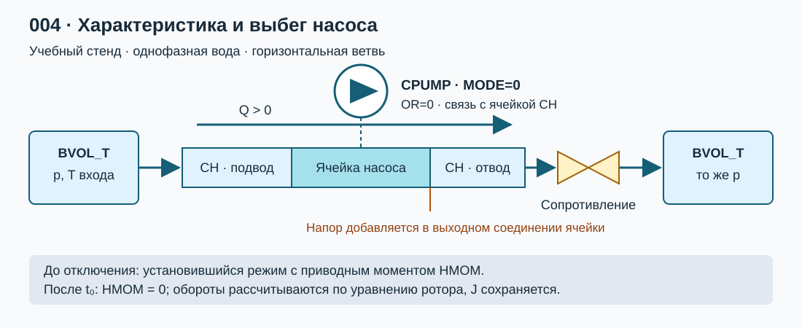

# Лабораторная работа №4. Исследование характеристики и выбега центробежного насоса

## 1. Цель работы

Корректно задать центробежный насос элементом **CPUMP с MODE=0 (полная модель)** в коде КОРСАР, проверить его напорную и моментную характеристики и исследовать выбег после отключения электропитания двигателя. Сопоставить расчет с уравнением движения ротора и опубликованными данными испытаний ГЦН ВВЭР-1000.

### Навыки, приобретаемые по результатам выполнения работы

- Подготовка зоны задания с элементами CH, CPUMP, BVOL_T и гидравлическими сопротивлениями.
- Перевод полной характеристики насоса в формат КОРСАР и ее проверка .
- Организация стационарного режима и события отключения приводного момента.
- Обработка временных зависимостей, проверка адекватности работы и сравнение с экспериментом.

## 2. Описание постановки задачи

### 2.1. Расчетный стенд

Используется отдельная горизонтальная гидравлическая ветвь: граничный объем на входе, канал с насосом, имитатор сопротивления контура и граничный объем на выходе. Давления в граничных объемах одинаковы; движение создается насосом. Реактор, парогенератор, другие петли и системы регулирования энергоблока не моделируются.

Нодализация расчетного варианта представлена на [рисунке 1](#fig-nodal).

<i>Рисунок 1 — Учебная схема стенда для испытания насоса</i>

Базовые параметры учебного стенда:

| Параметр | Значение или способ задания |
|---|---|
| Среда | Однофазная вода |
| Давление граничных объемов | 15,4 МПа |
| Температура воды на входе | 300 °C  |
| Высотный перепад | 0 м |
| Сечение и длина ячейки насоса | 0,5 м² и 6 м; приложение A спецификации [\[2\]](#ref-v1000ct), с. 91 |
| Подводящий и отводящий участки | По 5 м, сечение 0,5 м²; допущение |
| Эквивалентный диаметр круглого канала | $D=\sqrt{4S/\pi}$ |
| Сопротивление ветви | Подбирается по одной исходной рабочей точке; затем фиксируется |
| Событие отключения | После достижения стационарности; принять $t_0=20$ с и увеличить при необходимости |
| Продолжительность выбега | Не менее 240 с после отключения |

Подобрать сопротивление (имитация) 1 контура по уравнению $\Delta p_{\mathrm{сист}}=\zeta_{\Sigma}\rho v^2/2$ с учетом уже заданных потерь по длине. 

### 2.2. Исходные и проверочные данные

Основной источник характеристики насоса — V1000CT-1 [\[2\]](#ref-v1000ct). В приложении A отдельно приведены номинальные данные, полные характеристики и таблица выбега. Для этой работы использовать именно эти материалы.

| Величина | Значение из приложения A, с. 92 |
|---|---:|
| Номинальный объемный расход $Q_n$ | 5,88889 м³/с |
| Номинальный напор $H_n$ | 82,9 м |
| Номинальная угловая скорость $\Omega_n$ | 104,199 рад/с |
| Номинальный момент в исходной модели $M_n$ | 47 500 Н·м |
| Момент инерции агрегата $J$ | 7 600 кг·м² |
| Постоянный коэффициент момента трения исходной модели | 400 Н·м |

Начальная точка таблицы выбега отличается от номинальной точки характеристики: $Q_0=20000$ м³/ч, $\Delta p_0=6.5$ кгс/см², $\Omega_0=104.196$ рад/с.   
Сначала проверить номинальную характеристику, затем подготовить отдельный вариант для сравнения выбега.

Перенести таблицу выбега со с. 92–93 в CSV с исходными единицами и отдельными столбцами СИ. Проверочные точки:

| Время после отключения, с | Расход, м³/ч | Перепад давления, кгс/см² | Угловая скорость, рад/с |
|---:|---:|---:|---:|
| 0 | 20000 | 6,5 | 104,196 |
| 10 | 12850 | 2,70 | 67,02 |
| 30 | 7500 | 1,00 | 39,06 |
| 90 | 3200 | 0,15 | 15,71 |
| 232 | 0 | 0 | 0 |

Заголовок таблицы говорит о выбеге **четырех** насосов.

Второй источник [\[3\]](#ref-kalinin3) — **Kalinin-3 Coolant Transient Benchmark**, отключение одного из четырех работающих ГЦН при номинальной мощности. Для отдельного сравнения использовать перепад давления на отключенном ГЦН: приложение с экспериментальными данными, [рис. 7, с. 45], также [рис. 83, данные MMS](#ref-kalinin3). Оцифровать не менее 10 точек.  
[Рис. 3](../files/data/004_MCP_run/nsc-doc2009-5.pdf#page=43) показывает **мощность** ГЦН, а не частоту вращения.

Кривые [\[2\]](#ref-v1000ct) и [\[3\]](#ref-kalinin3) относятся к разным опытам.  Представить сравнение нормированных перепадов и объяснить особенности формы, включая возможность смены знака.

### 2.3. Задание полной модели CPUMP

Руководствоваться разделом 2.3.22 руководства [\[1\]](#ref-korsar), особенно таблицами 44 и 46, с. 99–112.

| Ключ | Содержание задания и проверка |
|---|---|
| `MODE=0` | Решение уравнения вращения ротора в стационарных опытах и на выбеге |
| `OR=0` | Ориентация совпадает с положительным направлением CH |
| `TYPE=1` | Учебный однофазный опыт без учета кавитации |
| `REVN`, `QN` | Номинальные скорость в рад/с и расход в м³/с |
| `DPN` | **Перепад в Па**: $DPN=\rho_{\mathrm{ref}}gH_n$;  |
| `PEXP`, `TEXP` | Давление и температура, соответствующие выбранной опорной плотности характеристики |
| `J` | Момент инерции вращающихся частей, кг·м² |
| `EFF1`, `EFF` | Полный и механический КПД, согласованные с номинальными моментами; $0<EFF1\le EFF\le1$ |
| `CP1`–`CP4`, `CM1`–`CM4` | Четыре ветви напорной и моментной круговых характеристик |
| `NP1`–`NP4`, `NM1`–`NM4` | Число точек каждой ветви |
| `F`, `D`, `K`, `REV0` | Закон механического трения по таблице 46 |
| `HMOM` | Приводной момент в Н·м; после отключения равен нулю |
| `REV` | **Относительная** скорость $\Omega/\Omega_n$; начальное значение около 1 |

### 2.4. Порядок выполнения работы

1. Составить сводку исходных данных.
2. Собрать нодализацию, получить статическое состояние, соответствующее номинальной трабочей точке насоса.
3. Получить не менее пяти стационарных точек в положительном насосном режиме, ориентировочно $q=0.6; 0.8; 1.0; 1.1; 1.2$, оставаясь на ветви с положительным напором и в диапазоне исходных данных. Расход изменять сопротивлением ветви. Для каждой точки подобрать постоянный `HMOM`, обеспечивающий $REV\approx1$; один номинальный момент не удерживает одинаковые обороты при всех расходах. Все точки считать с `MODE=0`. Как вариант - можно задать имитацию моментной характеристики двигателя вблизи рабочего момента.
4. Подготовить отдельный файл с процедурой отключения двигателя. В момент $t_0$ процедурой EVENT установить `HMOM.CPUMP1=0.` и сохранять нулевой момент далее. Оставить `MODE=0`, не задавать `REV(t)` и не обнулять обороты принудительно. Перед отключением отключить любой регулятор, который мог бы восстановить момент.
5. Для базового выбега уменьшить максимальный шаг времени вдвое. Сопоставить время достижения $w=0,5$ и временные кривые. Выводить данные чаще около отключения (рекомендуемый интервал до 0,1 с в первые 10 с, затем до 1 с); частота записи не заменяет проверку шага интегрирования.

### 2.5. Ручная оценка выбега

Уравнение ротора для положительного вращения имеет вид [формулы (2)](#eq-rotor-motion):

$$
J\frac{d\Omega}{dt}=M_{\mathrm{дв}}-M_{\mathrm{вн}}(Q,\Omega,\rho)-M_{\mathrm{тр}}(\Omega). \qquad (2)
$$

После отключения $M_{\mathrm{дв}}=0$. 

При постоянном сопротивляющем моменте $M_0$ решение [уравнения (2)](#eq-rotor-motion) описывается [формулой (3)](#eq-constant-torque):

$$
\Omega(t)=\max\left[0,\Omega_0-\frac{M_0}{J}(t-t_0)\right]. \qquad (3)
$$

При квадратичном моменте $M_{\mathrm{сопр}}=K_\Omega\Omega^2$, $K_\Omega=M_0/\Omega_0^2$ решение [уравнения (2)](#eq-rotor-motion) описывается [формулой (4)](#eq-quadratic-torque):

## 3. Требуемые результаты

- Паспорт насоса, таблицы преобразованных полных характеристик и проверка их стыков.
- Не менее пяти стационарных рабочих точек: $Q$, $H$, $\Delta p$, $\Omega$
- Графики $H(Q)$ и $h(q)$ вместе с исходной характеристикой.
- Сравнение базового выбега с таблицей [\[2\]](#ref-v1000ct), ручными аппроксимациями [(3)](#eq-constant-torque), оцифрованными данными Калининской АЭС-3 [\[3\]](#ref-kalinin3) и объяснение ограничений стенда.

Графики сохранять в `pic`: `qh_characteristic.png`, `coastdown.png`,  `kalinin_comparison.png` и др.

## 4. Формат отчетности

Представить `task/kordat`, `task/kutdat`, скрипты обработки, исходные и преобразованные таблицы .CSV, отчет `report.md` и рисунки в `pic`. 
За шаблон отчета принять [шаблон отчета](../000_simple_hr/report_template.md). 
[Инфо](../readme.md) по работе с репозиторием смотри в его корне.

## 5. Список литературы

1.  **КОРСАР/В3. Руководство пользователя.**
2.  **Ivanov B., Ivanov K., Groudev P., Pavlova M., Hadjiev V.** VVER-1000 Coolant Transient Benchmark. Phase 1 (V1000CT-1), Vol. I: Main Coolant Pump (MCP) Switching On — Final Specifications. OECD/NEA, 2002. NEA/NSC/DOC(2002)6. [Публикация](https://www.academia.edu/18579831/VVER_1000_Coolant_Transient_Benchmark_Main_coolant_pump_MCP_switching_on_Final_specifications)
3.  **Tereshonok V. A., Nikonov S. P., Lizorkin M. P., Velkov K., Pautz A., Ivanov K.** Kalinin-3 Coolant Transient Benchmark — Switching-Off of One of the Four Operating Main Circulation Pumps at Nominal Reactor Power. Specification, First Edition, 2008; NEA/NSC/DOC(2009)5. [PDF по заданной ссылке](https://gifsymposium2018.gen-4.org/upload/docs/application/pdf/2020-01/nsc-doc2009-5.pdf)
4. ...

## 6. Контрольные вопросы

1. Чем отличаются MODE=0, 1 и 2? Почему заданная зависимость оборотов от времени не проверяет расчет выбега?
2. Как интерпретировать четырехквадрантную характеристику? Как соотнести ее с простой H-Q кривой?
3. Какие условия проверяют на стыках круговых характеристик и по знаку диссипации?
4. Чем различаются внутренний момент, приводной момент и момент механического трения? Как они связаны с EFF и EFF1?
5. Почему постоянный момент двигателя не обеспечивает номинальные обороты при любом сопротивлении сети?
6. Какие недостатки имеет созданный "виртуальный стенд"?

## Сокращения и обозначения

ГЦН — главный циркуляционный насос; $Q$ — объемный расход, м³/с; $H$ — напор, м; $\Delta p$ — перепад давления, Па; $\Omega$ — угловая скорость, рад/с; $J$ — момент инерции, кг·м²; $M$ — вращающий момент, Н·м; $q,w,h,m$ — относительные величины; индекс $n$ — номинальный режим характеристики, индекс $0$ — начало выбега.
