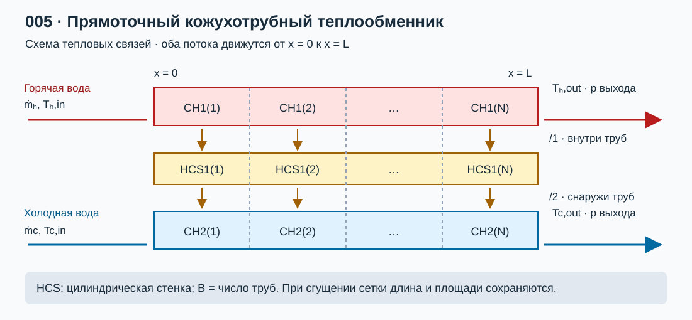

# Лабораторная работа №5. Исследование прямоточного кожухотрубного теплообменника

## 1. Цель работы

Собрать в КОРСАР модель прямоточного кожухотрубного теплообменника из **двух каналов CH и разделяющей их теплопроводящей конструкции HCS**. Для однофазного течения воды по обоим трактам определить тепловую мощность, выходные температуры, эффективность и тепловую проводимость $kF=UA$. Сопоставить результаты с методом водяных эквивалентов ($\varepsilon$–NTU) и исследовать влияние разбиения поверхности по длине.

### Навыки, приобретаемые по результатам выполнения работы

- Эквивалентирование трубного пучка и межтрубного пространства одномерными каналами.
- Задание цилиндрической HCS и ее тепловых связей с двумя потоками.
- Расчет водяных эквивалентов, эффективности, NTU и выходных температур.
- Определение $kF$ через сопротивления теплопередаче и по результатам теплового баланса.
- Разделение сеточной погрешности, влияния теплофизических свойств и особенностей замыкающих соотношений КОРСАР.

## 2. Описание постановки задачи

### 2.1. Геометрия и нодализация

Горячая вода движется внутри одинаковых прямых труб; холодная вода — вдоль труб в межтрубном пространстве. Оба потока направлены от $x=0$ к $x=L$. Пучок одноходовой, без поперечных перегородок, перепусков и смешения потоков между трактами; наружная поверхность кожуха теплоизолирована. Это учебная идеализация кожухотрубного аппарата с продольным обтеканием, а не модель стандартного многоходового аппарата с сегментными перегородками.

Нодализация расчетного варианта представлена на [рисунке 1](#fig-nodal).

<a id="fig-nodal"></a>



*[Рисунок 1 — Прямоточная схема теплообменника: два канала CH и разделяющая их HCS](./pic/nodal.svg).*

CH1 представляет суммарное проходное сечение всех труб, CH2 — свободное межтрубное сечение, HCS1 — стенки всех труб. Для обоих CH и HCS принять одинаковое число участков по длине $N$ и $\Delta x=L/N$.

Тепловые связи в LAYOUT для выбранной нумерации:

```text
HCS1(1:N)/1 - CH1(1:N);
HCS1(1:N)/2 - CH2(1:N);
```

Здесь `N` — обозначение числа ячеек; перед использованием фрагмента подставить число или корректно объявленный параметр своей зоны задания. Для цилиндрической HCS поверхность 1 — внутренняя, поверхность 2 — наружная (раздел 2.3.16.1 [\[1\]](#ref-korsar)). Обратная нумерация одного канала при той же ориентации связей меняет схему теплообмена и не соответствует заданному прямотоку.

| Параметр | Базовое значение |
|---|---:|
| Число одинаковых труб $n_t$ | 20 |
| Рабочая длина $L$ | 3 м |
| Внутренний диаметр трубы $d_i$ | 0,010 м |
| Наружный диаметр трубы $d_o$ | 0,012 м |
| Внутренний диаметр кожуха $D_s$ | 0,080 м |
| Теплопроводность стенки $\lambda_w$ | 16 Вт/(м·К), постоянная учебная аппроксимация стали |
| Плотность и теплоемкость стенки | 7900 кг/м³ и 500 Дж/(кг·К) |
| Давление на выходе каждого тракта | 1,0 МПа |
| Входные температуры $T_{h,in}$, $T_{c,in}$ | 80 и 20 °C |
| Массовые расходы $\dot m_h$, $\dot m_c$ | 1,0 и 1,0 кг/с |
| Загрязнение поверхности, теплопотери наружу | Не учитываются |
| Сетки по длине | $N=1,2,5,10,20,40,80$ |
| Сетка стенки по толщине | Сначала 5 узлов; проверить 9 узлами на сгущенной продольной сетке |

Геометрические параметры перед заданием модели рассчитать по [формуле (1)](#eq-flow-areas) для проходных сечений и [формуле (2)](#eq-diameters-heat-areas) для диаметров и площадей теплообмена:

<a id="eq-flow-areas"></a>

$$
S_h=n_t\frac{\pi d_i^2}{4},\qquad S_c=\frac{\pi}{4}(D_s^2-n_t d_o^2), \qquad (1)
$$

<a id="eq-diameters-heat-areas"></a>

$$
D_{h,h}=d_i,\qquad D_{h,c}=\frac{4S_c}{\pi D_s+n_t\pi d_o},
\qquad F_i=n_t\pi d_iL,\quad F_o=n_t\pi d_oL. \qquad (2)
$$

Для выбранных размеров $S_h\approx0,001571$ м², $S_c\approx0,002765$ м², $D_{h,c}\approx0,0110$ м, $F_i\approx1,885$ м², $F_o\approx2,262$ м². Гидравлический периметр CH2 включает кожух и трубы; обогреваемый периметр — только трубы. Поэтому площадь теплообмена нельзя находить через полный смоченный периметр межтрубного канала.

Использовать цилиндрическую HCS (`COOR=1`), радиусы $d_i/2$ и $d_o/2$, множитель `B=n_t`. Суммарные площади должны равняться $F_i$ и $F_o$ **при любой сетке**. Не умножать площадь на число труб одновременно геометрией и повторным коэффициентом. Выбрать `TYPE=0` для теплопроводности поперек стенки без осевого переноса; внутреннее энерговыделение равно нулю. Указать выбранные модели трения и теплоотдачи. Геометрический признак `NGE` не является способом произвольно задать постоянный коэффициент теплоотдачи.

На входах обеспечить заданные массовые расходы и температуры с помощью подходящих граничных элементов (например, SMASS_T), на выходах — давление через BVOL_T. Конкретные связи и смысл температуры источника проверить по разделам 2.3.15 и 2.3.16 [\[1\]](#ref-korsar). Допустим вариант с подбором входного давления, если фактические расходы воспроизводят задание. Не фиксировать независимо расход и оба граничных давления одного тракта. Граничные/подводящие ячейки не включать в активную площадь HCS.

Во всех режимах подтвердить однофазность воды, проверить давление и температуру относительно насыщения, а также числа Re по фактическим свойствам. Температуры в зоне задания переводить в К. Для исходных температур до 120 °C выходное давление 1 МПа позволяет организовать однофазный опыт; фактический минимум давления все равно проверяется по расчету.

### 2.2. Метод водяных эквивалентов и NTU

Тепловую мощность обозначать $\dot Q$ (Вт), чтобы не смешивать ее с объемным расходом. Водяные эквиваленты — расходные теплоемкости, определяемые по [формуле (3)](#eq-heat-capacity-rates):

<a id="eq-heat-capacity-rates"></a>

$$
C_h=\dot m_hc_{p,h},\quad C_c=\dot m_cc_{p,c},\quad
C_{min}=\min(C_h,C_c),\quad C_{max}=\max(C_h,C_c),\quad C_r=C_{min}/C_{max}. \qquad (3)
$$

$C_h$ и $C_c$ измеряются в Вт/К, а не в Дж/К. Введем тепловую проводимость аппарата $\mathcal K=kF=UA$ (Вт/К) и число единиц переноса по [формуле (4)](#eq-ntu):

<a id="eq-ntu"></a>

$$
NTU=\frac{\mathcal K}{C_{min}}. \qquad (4)
$$

При постоянных свойствах и коэффициенте теплопередачи эффективность **прямотока** и мощность определяются по [формуле (5)](#eq-parallel-effectiveness), а выходные температуры — по [формуле (6)](#eq-outlet-temperatures) [\[3\]](#ref-rd-heat-exchangers), [\[5\]](#ref-incropera), [\[6\]](#ref-holman):

<a id="eq-parallel-effectiveness"></a>

$$
\varepsilon=\frac{1-\exp[-NTU(1+C_r)]}{1+C_r},\qquad
\dot Q=\varepsilon C_{min}(T_{h,in}-T_{c,in}), \qquad (5)
$$

<a id="eq-outlet-temperatures"></a>

$$
T_{h,out}=T_{h,in}-\frac{\dot Q}{C_h},\qquad
T_{c,out}=T_{c,in}+\frac{\dot Q}{C_c}. \qquad (6)
$$

Максимально возможная мощность в определении эффективности — $\dot Q_{max}=C_{min}(T_{h,in}-T_{c,in})$. При этом для прямотока $\varepsilon\le1/(1+C_r)$; при равных водяных эквивалентах предел составляет 0,5. При конечной положительной проводимости выходная температура горячего потока выше выходной температуры холодного.

Определить выходные температуры также для заданной мощности $\dot Q_{зад}$ по [тепловому балансу (6)](#eq-outlet-temperatures), затем вычислить требуемую проводимость по [формуле (7)](#eq-required-conductance):

<a id="eq-required-conductance"></a>

$$
\varepsilon_{зад}=\frac{\dot Q_{зад}}{C_{min}(T_{h,in}-T_{c,in})},\qquad
\mathcal K_{треб}=-\frac{C_{min}}{1+C_r}\ln[1-\varepsilon_{зад}(1+C_r)]. \qquad (7)
$$

Конечное положительное решение существует при $0<\varepsilon_{зад}<1/(1+C_r)$. Таким образом, мощность, поверхность, входные условия и расходы нельзя назначить независимо. В основном поверочном расчете КОРСАР мощность получается как результат; заданная мощность используется для отдельной проектной оценки, а не как дополнительное энерговыделение в HCS.

### 2.3. Расчет $kF$ и сопоставление с КОРСАР

Для чистых цилиндрических труб при постоянных коэффициентах теплоотдачи проводимость определяется через термические сопротивления по [формуле (8)](#eq-thermal-resistances):

<a id="eq-thermal-resistances"></a>

$$
\frac{1}{\mathcal K}=\frac{1}{\alpha_hF_i}
+\frac{\ln(d_o/d_i)}{2\pi\lambda_wn_tL}
+\frac{1}{\alpha_cF_o}. \qquad (8)
$$

Здесь $k_i=\mathcal K/F_i$ и $k_o=\mathcal K/F_o$ различны, но произведения $k_iF_i=k_oF_o$ одинаковы. В отчете всегда указывать, к какой поверхности отнесен $k$. При введении загрязнения добавить соответствующие термические сопротивления.

Выполнить два уровня сопоставления:

1. **Независимая инженерная оценка.** Рассчитать свойства воды при средних температурах потоков и выбранном давлении; по Re и Pr выбрать применимые зависимости теплоотдачи из [\[2\]](#ref-rtm-heat-exchangers)–[\[4\]](#ref-isachenko), получить $\alpha_h$, $\alpha_c$, $\mathcal K$ и прогноз NTU. Итерационно уточнить средние температуры. Для наружного продольного обтекания пучка явно указать примененную корреляцию и пределы ее применимости; замена пучка эквивалентной круглой трубой является приближением.
2. **Проверка теплового расчета при коэффициентах КОРСАР.** Вывести локальные `ALW` на обеих сторонах HCS. Рассчитать $\mathcal K_j$ каждого участка по [формуле (8)](#eq-thermal-resistances) с его действительными площадями и суммарную проводимость $\sum_j\mathcal K_j$. При постоянных расходных теплоемкостях использовать эту сумму в формуле прямотока; при заметном изменении свойств выполнить последовательный расчет по участкам с локальными $c_p$ и $\mathcal K_j$. Такой расчет проверяет согласованность теплопередачи, но не является независимой проверкой корреляций теплоотдачи КОРСАР.

Для каждого стационарного варианта вычислить мощности по энтальпиям и невязку баланса по [формуле (9)](#eq-enthalpy-balance):

<a id="eq-enthalpy-balance"></a>

$$
\dot Q_h=\dot m_h(i_{h,in}-i_{h,out}),\qquad
\dot Q_c=\dot m_c(i_{c,out}-i_{c,in}),\qquad
r_E=\frac{|\dot Q_h-\dot Q_c|}{\max(|\dot Q_h|,|\dot Q_c|)}. \qquad (9)
$$

При малой мощности приводить также абсолютную невязку в Вт. Учесть накопление энергии в стенке и воде, если стационарность еще не достигнута; оценить гидравлическую диссипацию, если она существенна. После проверки баланса допустимо принять $\dot Q_{К}=(\dot Q_h+\dot Q_c)/2$.

Независимо от баланса потоков просуммировать тепловые мощности HCS: `QW(1,j)` — от поверхности 1 к жидкости CH1, `QW(3,j)` — от поверхности 2 к жидкости CH2. При принятой ориентации горячая сторона имеет отрицательный поток от стенки к жидкости, холодная — положительный; `QW` измеряется в **Вт**, повторно умножать его на площадь нельзя. Вывести также температуры поверхностей `TW`, среды `TENV` и коэффициенты `ALW` (раздел 2.3.16 [\[1\]](#ref-korsar)).

Оценить эффективную проводимость по концевым температурам и среднелогарифмическому напору по [формуле (10)](#eq-lmtd-conductance):

<a id="eq-lmtd-conductance"></a>

$$
\Delta T_1=T_{h,in}-T_{c,in},\quad
\Delta T_2=T_{h,out}-T_{c,out},\quad
\Delta T_{lm}=\frac{\Delta T_1-\Delta T_2}{\ln(\Delta T_1/\Delta T_2)},\quad
\mathcal K_{бал}=\frac{\dot Q_{К}}{\Delta T_{lm}}. \qquad (10)
$$

При почти равных напорах использовать предельное значение $\Delta T_{lm}\approx\Delta T_1$, избегая численного деления малых величин. При неположительном концевом напоре сначала проверить постановку. Проводимость $\mathcal K_{бал}$ восстановлена из того же расчета, поэтому обратная подстановка ее в NTU сама по себе не доказывает точность модели. Сопоставить ее с оценкой по сопротивлениям и объяснить влияние переменных свойств.

### 2.4. Матрица режимов и сеточное исследование

Выполнить **каждый** режим таблицы на всех сетках $N=1,2,5,10,20,40,80$. Геометрия аппарата, число труб, граничные условия, физические модели и суммарная площадь при сгущении сетки сохраняются.

| Режим | $T_{h,in}$ / $T_{c,in}$, °C | $\dot m_h$ / $\dot m_c$, кг/с | Назначение |
|---|---:|---:|---|
| A | 80 / 20 | 1,0 / 1,0 | Базовый режим, близкие водяные эквиваленты |
| B | 40 / 30 | 1,0 / 1,0 | Малый входной температурный напор, 10 К |
| C | 120 / 20 | 1,0 / 1,0 | Большой входной напор, 100 К, влияние свойств |
| D | 80 / 20 | 0,5 / 2,0 | Меньший водяной эквивалент горячей стороны |
| E | 80 / 20 | 2,0 / 0,5 | Меньший водяной эквивалент холодной стороны |
| F | 80 / 20 | 0,25 / 0,25 | Повышенный NTU; проверить возможную смену режима течения |

Для A выполнить проектную оценку при $\dot Q_{зад}=50$ кВт: рассчитать обе выходные температуры по [формуле (6)](#eq-outlet-temperatures) и $\mathcal K_{треб}$ по [формуле (7)](#eq-required-conductance). Для D и E повторить при 30 кВт. Проверить достижимость этих мощностей в прямотоке. Не изменять площадь основной матрицы для принудительного получения заданной мощности; сравнить требуемую проводимость с фактической.

Порядок исследования:

1. Рассчитать геометрию, свойства, Re, Pr и начальные оценки NTU. Показать ожидаемые режимы теплоотдачи на обеих сторонах.
2. Собрать базовый вариант с $N=10$, вывести его на стационарный режим. Ориентир: изменения выходных температур менее 0,01 К за последние 20 с, мощности — менее 0,1%, невязка теплового баланса — менее 0,5%. Если условия не выполнены, продолжить расчет или объяснить источник невязки.
3. Выполнить матрицу. Для каждой сетки привести $\dot Q_h$, $\dot Q_c$, $T_{h,out}$, $T_{c,out}$, $\varepsilon$, $\sum_j\mathcal K_j$, $\mathcal K_{бал}$ и $r_E$. Температуры сравнивать на границах активной поверхности, а не в произвольных центрах крайних ячеек.
4. Построить $T_h(x)$, $T_c(x)$, температуры обеих поверхностей стенки, $\alpha_h(x)$, $\alpha_c(x)$ и тепловой поток по длине. Показать, как сгущение разрешает большой локальный градиент возле общего входа.
5. Для последовательных сеток оценить $\delta_Q=|\dot Q_{N_2}-\dot Q_{N_1}|/|\dot Q_{N_2}|$ и абсолютные изменения выходных температур. За сеточно независимый ориентир принять менее 1% по мощности и менее 0,1 К по каждой выходной температуре на **двух последних сгущениях**. Если на $N=80$ критерий не достигнут, добавить $N=160$; не считать последнюю сетку точной автоматически.
6. На выбранной сгущенной сетке отдельно уменьшить максимальный шаг времени вдвое и изменить число узлов стенки с 5 до 9. Проверить, что эти эффекты меньше исследуемого влияния продольной сетки.
7. Сопоставить режимы B, A, C. При постоянных свойствах и постоянном $\mathcal K$ нормированное решение определяется NTU и $C_r$, а не абсолютным входным напором. Изменение относительной сеточной ошибки с напором в КОРСАР объяснить изменением свойств, теплоотдачи, локальных градиентов и абсолютных критериев остановки; не объявлять его заранее обязательным монотонным эффектом.
8. Сопоставить D и E, затем F с A. Разделить влияние отношения водяных эквивалентов, NTU и смены режима течения. Сформулировать обоснованную рекомендацию по числу участков для каждого режима.

### 2.5. Контрольный аналитический пример

Для проверки собственных формул принять **условно** $c_{p,h}=c_{p,c}=4180$ Дж/(кг·К), $\dot m_h=\dot m_c=1$ кг/с, $\mathcal K=4180$ Вт/К, температуры на входе 80 и 20 °C. Тогда $C_r=1$, $NTU=1$; подстановка в [формулы (5)](#eq-parallel-effectiveness) и [(6)](#eq-outlet-temperatures) дает контрольные значения [(11)](#eq-example-effectiveness) и [(12)](#eq-example-temperatures):

<a id="eq-example-effectiveness"></a>

$$
\varepsilon=(1-e^{-2})/2\approx0,43233, \qquad (11)
$$

<a id="eq-example-temperatures"></a>

$$
\dot Q\approx108,43\ \text{кВт},\quad T_{h,out}\approx54,06\ ^\circ\text{C},\quad T_{c,out}\approx45,94\ ^\circ\text{C}. \qquad (12)
$$

Это проверка арифметики метода, а не заранее известный результат КОРСАР для заданной геометрии: реальная проводимость определяется теплоотдачей и стенкой. В учебном проектном примере A при 50 кВт и том же постоянном $c_p$ получаются около 68,04 и 31,96 °C и $\mathcal K_{треб}\approx1063$ Вт/К.

## 3. Требуемые результаты

- Нодализация двух CH и HCS, расчет проходных сечений, гидравлических диаметров, площадей и теплового сопротивления стенки.
- Для характерных режимов — водяные эквиваленты, $C_r$, NTU, эффективность, $kF=UA$, мощность и обе выходные температуры; отдельная проектная оценка заданной мощности.
- Сравнение КОРСАР с независимым расчетом NTU и расчетом по локальным коэффициентам теплоотдачи КОРСАР. Привести абсолютные и относительные расхождения, причины отличий и проверку баланса.
- Профили температур и теплоотдачи; графики мощности, эффективности и выходных температур в зависимости от числа участков по длине.
- Таблица сеточной сходимости **для всех шести режимов**, оценка влияния малого и большого температурных напоров, расходов и числа узлов стенки.
- Вывод о достаточной сетке и границах применения метода водяных эквивалентов к рассмотренной модели.

Результирующие рисунки сохранять в `pic` под именами `temperature_profiles.png`, `ntu_comparison.png`, `mesh_convergence.png`, `local_heat_transfer.png`. Эти графики строятся обучающимся после выполнения расчетов; в задании дана только схема нодализации.

## 4. Формат отчетности

Представить файлы `task/kordat` и `task/kutdat`, параметры всех вариантов или скрипт их формирования, обработчик результатов на Python/Jupyter, сводные таблицы CSV, отчет `report.md` и рисунки в `pic`.

Отчет должен содержать исходные данные, допущения, геометрию, нодализацию, формулы и источники корреляций, описание запуска, матрицу режимов, результаты NTU и КОРСАР, тепловые балансы, анализ сходимости и выводы. Указать версию кода, ограничения шага времени, критерии стационарности и единицы всех величин. За основу оформления взять [000_simple_hr](../000_simple_hr/readme.md) и [шаблон отчета](../000_simple_hr/report_template.md). Бинарные результаты в репозиторий не включать. README является заданием, а не готовым решением лабораторной работы.

## 5. Список литературы

1. <a id="ref-korsar"></a> **КОРСАР/В3. Руководство пользователя.** [Локальный PDF](../files/distr/um_v3_ru.pdf). Разделы о CH и BVOL_T; 2.3.15 «SMASS_T», с. 69–71; 2.3.16 «HCS», с. 71–88: тепловые связи, COOR, B, TYPE, TW, ALW, QW.
2. <a id="ref-rtm-heat-exchangers"></a> **РТМ 24.031.05-72. Методика и зависимости для теоретического расчета теплообмена и гидравлического сопротивления теплообменного оборудования АЭС.** [PDF](https://www.tep.am/Library/Normativs/%D0%A0%D0%A2%D0%9C%2024.031.05-72.pdf). Раздел 1.3 — теплопередача и температурный напор, в частности пп. 1.3.11–1.3.17; последующие разделы — зависимости теплоотдачи и сопротивления. Используется как отечественный источник расчетных зависимостей. Изложение метода через водяные эквиваленты и эффективность см. непосредственно в [\[3\]](#ref-rd-heat-exchangers) и [\[4\]](#ref-isachenko); не подменять его одной формулой среднего температурного напора из РТМ.
3. <a id="ref-rd-heat-exchangers"></a> **РД 24.035.05-89. Методические указания. Тепловой и гидравлический расчет теплообменного оборудования АЭС.** [PDF](https://www.tep.am/Library/Normativs/%D0%A0%D0%94%2024.035.05-89.pdf). **Проверенные разделы:** 2.2 — баланс, 2.3 и таблица 1 — эффективность в зависимости от параметра теплопередачи и отношения водяных эквивалентов; 2.4.3 — расчет через эффективность; 2.5 — выходные температуры и профили; справочное приложение 4 — размерные и безразмерные параметры. Это РД, а не РТМ; документ введен взамен РТМ 108.031.05-84. Здесь непосредственно изложен метод, сопоставляемый с $\varepsilon$–NTU.
4. <a id="ref-isachenko"></a> **Исаченко В. П., Осипова В. А., Сукомел А. С. Теплопередача.** 3-е изд., перераб. и доп. М.: Энергия, 1975. 488 с. [Каталог СПбПУ](https://elib.spbstu.ru/dl/2/ek21-28.pdf/info), [текст книги](https://djvu.online/file/BXpZJMYm45EsC). **Проверено по тексту:** глава 19, §19-2, с. 443, формула (19-5) вводит расходную теплоемкость $C=Gc_p$ и термин «водяной эквивалент»; §19-4 рассматривает расчет конечных температур и распределений для прямотока и противотока, включая зависимость от отношения расходных теплоемкостей и $kF/C$. Глава 20 — гидродинамический расчет аппаратов.
5. <a id="ref-incropera"></a> **Bergman T. L., Lavine A. S., Incropera F. P., DeWitt D. P. Fundamentals of Heat and Mass Transfer.** 8th ed. Wiley. Глава 11: §11.3 — LMTD для прямотока и противотока; §11.4 «Heat Exchanger Analysis: The Effectiveness–NTU Method», §11.4.2 — связи эффективности и NTU для разных схем; §11.5 — проектные и поверочные расчеты. [Оглавление издателя, ISBN 9781119722489](https://catalogimages.wiley.com/images/db/pdf/9781119722489.toc.pdf); в этой версии §11.4 начинается на с. 508. Нумерацию страниц не переносить на другие издания.
6. <a id="ref-holman"></a> **Holman J. P. Heat Transfer.** 10th ed. McGraw-Hill, 2010. Глава 10 «Heat Exchangers», §10-6 «Effectiveness–NTU Method», с. 540 и далее — эффективность прямоточных, противоточных и других теплообменников; §10-8 — переменные свойства. [Учебник в библиотеке ВКТУ](https://www.ektu.kz/files/DistanceEducation/Resource/950667/Heat%20transfer%2010%20ed%20by%20Holman.pdf).

В этой работе старые РТМ и РД используются как учебные методические источники, а не как подтверждение соответствия современным требованиям проектирования. При выборе корреляций выписать диапазоны Re, Pr и геометрические ограничения. Название «водяной эквивалент» не ограничивает метод водой: определяющей величиной является расходная теплоемкость потока.

## 6. Контрольные вопросы

1. Что такое водяной эквивалент и каковы его единицы? Чем он отличается от теплоемкости объема жидкости?
2. Как связаны метод водяных эквивалентов и $\varepsilon$–NTU? Что означают NTU и $C_r$?
3. Каковы **границы применимости метода водяных эквивалентов**: стационарность, изменение $c_p$ и $k$, фазовые переходы, осевая теплопроводность, теплопотери, байпасы и неравномерность течения? Когда нужен расчет по участкам?
4. Почему эффективность прямотока при равных расходных теплоемкостях не превышает 0,5? Могут ли пересечься выходные температуры?
5. Какой поток определяет максимально возможную тепловую мощность и почему?
6. Чем проектный расчет отличается от поверочного? Какие исходные параметры нельзя задавать независимо?
7. Почему $k_i$ и $k_o$ различаются, а $k_iF_i=k_oF_o$? Как учитывать цилиндрическую стенку?
8. Как определить сечение и гидравлический диаметр межтрубного пространства? Почему смоченный и теплообменный периметры различаются?
9. Как через CH и HCS воспроизвести прямоток? Что изменится при обратной нумерации тепловых связей одного тракта?
10. Что означают B, COOR и TYPE в HCS? Как избежать ошибочного увеличения площади при сгущении сетки?
11. Почему одна ячейка по длине может искажать тепловую мощность, даже если общий тепловой баланс выполнен?
12. Как различить влияние продольной сетки, сетки стенки, шага времени и неполной стационарности?
13. Как изменение расходов влияет одновременно на водяные эквиваленты и коэффициенты теплоотдачи?
14. Почему при постоянных свойствах увеличение входного температурного напора само по себе не меняет эффективность? Почему это может не выполняться в КОРСАР?
15. Почему расчет NTU с $UA$, восстановленным по тем же выходным температурам, не является независимой валидацией?
16. Когда можно использовать среднюю теплоемкость, а когда тепловой баланс следует считать через энтальпии?
17. Чем эффективность $\varepsilon$ отличается от отношения отданной и полученной потоками теплоты? Почему хороший баланс не означает высокую эффективность?

## Сокращения и обозначения

CH — канал; HCS — теплопроводящая конструкция; $\dot m$ — массовый расход, кг/с; $\dot Q$ — тепловая мощность, Вт; $C=\dot mc_p$ — водяной эквивалент, Вт/К; $k$ ($U$) — коэффициент теплопередачи, Вт/(м²·К); $F$ ($A$) — площадь теплообмена, м²; $\mathcal K=kF=UA$ — тепловая проводимость, Вт/К; $\alpha$ — коэффициент теплоотдачи; $\varepsilon$ — эффективность; NTU — число единиц переноса; LMTD — среднелогарифмический температурный напор; индексы $h,c$ — горячая и холодная стороны, $in,out$ — вход и выход, $i,o$ — внутренняя и наружная поверхности трубы.
