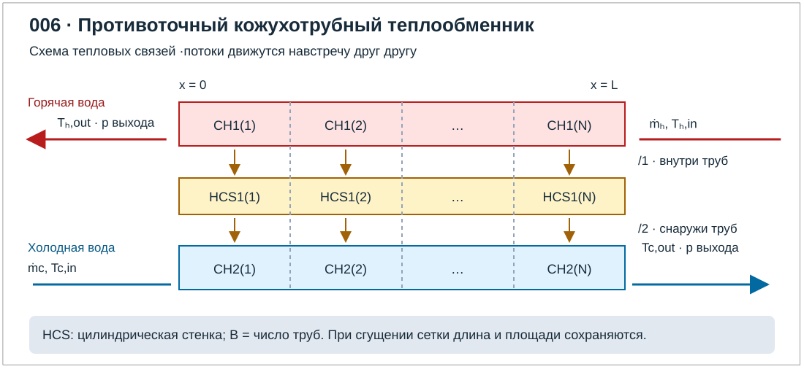
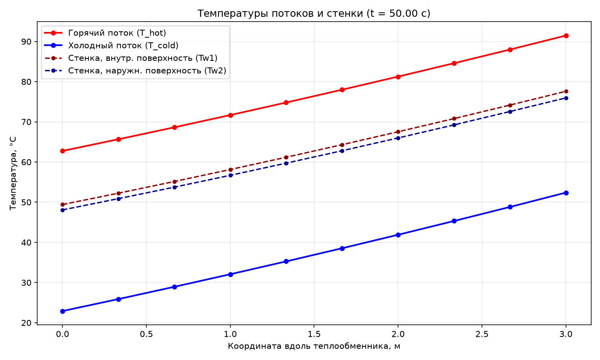
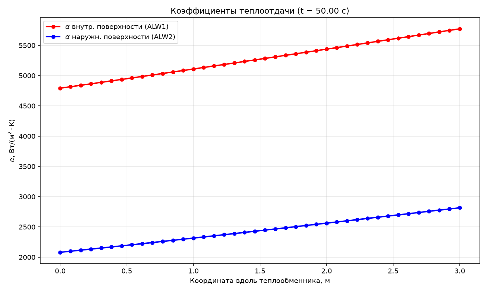
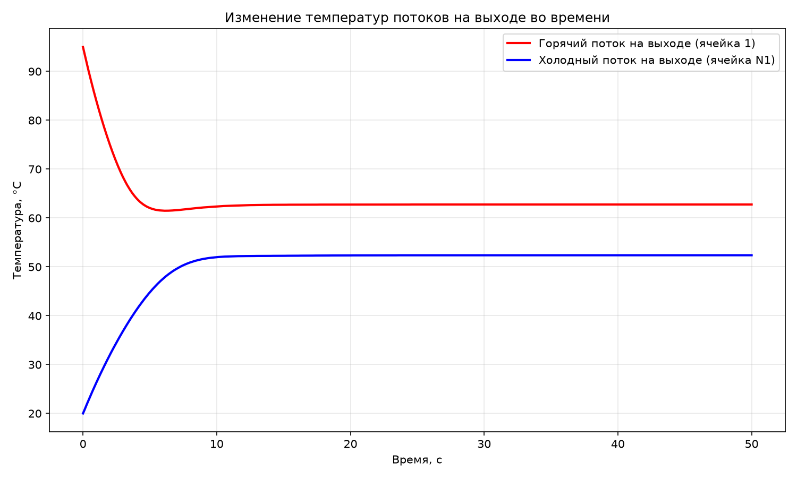
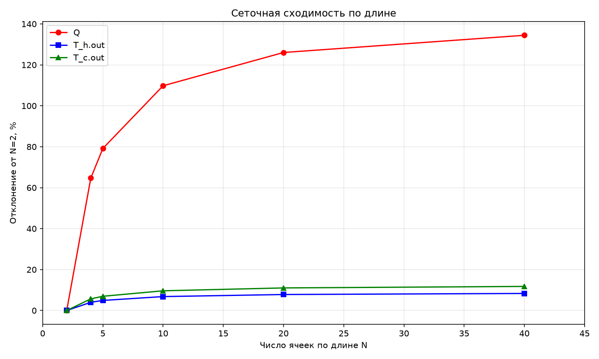
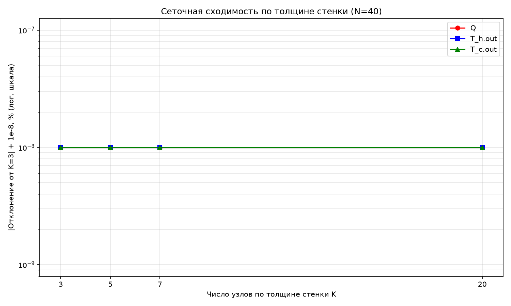

# Лабораторная работа №6. Исследование противоточного кожухотрубного теплообменника

## 1. Цель работы

Собрать в КОРСАР модель противоточного кожухотрубного теплообменника из **двух каналов и разделяющей их теплопроводящей конструкции**. Для однофазного течения воды по обоим трактам определить тепловую мощность, выходные температуры, эффективность и тепловую проводимость $kF=UA$. Сопоставить результаты с методом водяных эквивалентов (в иностранной литературе именуемого методом тепловых единиц *NTU*) и исследовать влияние разбиения поверхности по длине.

### Навыки. приобретаемые по результатам выполнения работы

- Моделирование рекуперативного теплообменника при помощи одномерного кода  
- Расчет водяных эквивалентов. эффективности. NTU и выходных температур  
- Определение $kF$ через сопротивления теплопередаче и по результатам теплового баланса  
- Представление характеристик теплообменника в графической и цифровой формах

## 2. Описание постановки задачи

### 2.1. Геометрия и нодализация

Горячая вода движется во внутритрубной полости; холодная вода — в межтрубном пространстве. Потоки направлены в разные стороны: один от $x=0$ к $x=L$, другой - обратно (противоток). Пучок одноходовой, без поперечных перегородок, перепусков и смешения потоков между трактами; наружная поверхность кожуха теплоизолирована.

Возможная нодализация расчетного варианта представлена на рисунке:

CH1 представляет суммарное проходное сечение всех труб. CH2 — свободное межтрубное сечение. HCS1 — стенки всех труб. Для обоих CH и HCS принять одинаковое число участков по длине $N$ и $\Delta x=L/N$.

| Параметр | Базовое значение |
|---|---:|
| Число одинаковых труб $n_t$ | 20 |
| Рабочая длина $L$ | 3 м |
| Внутренний диаметр трубы $d_i$ | 0.010 м |
| Наружный диаметр трубы $d_o$ | 0.012 м |
| Внутренний диаметр кожуха $D_s$ | 0.080 м |
| Материал стенки | перлитная сталь |
| Давление на выходе каждого тракта | 1.0 МПа |
| Входные температуры $T_{h.in}$. $T_{c.in}$ | 95 и 20 °C |
| Массовые расходы $\dot m_h$. $\dot m_c$ | 1.0 и 1.0 кг/с |
| Загрязнение поверхности. теплопотери наружу | Не учитываются |

Для количества разбиений теплообменника на участки, числа слоев стенки по радиусу и числа труб ввести специальные параметры.

### 2.2 Проверка на сеточную сходимость
Провести анализ влияния подробности разбиения теплообменной поверхности по длине трубок и по радиусу стенки. Результаты оценки сеточной сходимости по обоим параметрам представить графически (не менее 4-х уровней подробности по кадому разбиению) в виде относительного отклонения от самого "грубого" расчета. Для серии расчетов на сеточную сходимость оценить численную ошибку дискретизации задачи по методу *GCI* Роуча [\[7\]](#ref-roache). 

### 2.3 Метод водяных эквивалентов и NTU

Ручной расчет мощности теплообменника при заданных входных параметрах можно проводить различными методами, в т.ч. и методом водяных эквивалентов [\[3\]](#ref-rd-heat-exchangers), который в зарубежной литературе также известен как "метод тепловых единиц NTU" [\[5\]](#ref-incropera). [\[6\]](#ref-holman). Для расчета теплообменника по данному методу нужно оценить среднее значение массовых теплоемкостей потоков, а также среднюю тепловую проводимость (величину, обратную среднему термическому сопротивлению) [формула (1)](#eq-thermal-resistances):

$$
\frac{1}{\mathcal K}=\frac{1}{\alpha_hF_i}
+\frac{\ln(d_o/d_i)}{2\pi\lambda_wn_tL}
+\frac{1}{\alpha_cF_o}. \qquad (1)
$$

Здесь $k_i=\mathcal K/F_i$ и $k_o=\mathcal K/F_o$ различны. но произведения $k_iF_i=k_oF_o$ одинаковы. 

Выполнить два уровня сопоставления для **статического режима**:

1. **Сопоставление коэффициентов теплоотдачи**   
   > Рассчитать свойства воды при средних температурах потоков и выбранном давлении; по Re и Pr выбрать применимые зависимости теплоотдачи из [\[2\]](#ref-rtm-heat-exchangers)–[\[4\]](#ref-isachenko). получить $\alpha_h$. $\alpha_c$, сравнить с данными, полученными в коде КОРСАР (вывести распределения по длине и средние значения). 
2. **Сопоставление результатов расчета теплообменника**  
   > Сравнить результаты расчета выходных температур сред и мощности теплообменника при заданных параметрах на граничных условиях задачи. Проверку расчета провести также с использованием формулы *среднелогарифмического* температурного напора (*log-mean temperature difference, LMTD*).

Для каждого *стационарного* варианта вычислить относительные отклонения указанных показателей

## 3. Требуемые результаты

- Сравнение результатов расчета КОРСАР с независимым расчетом NTU и расчетом по локальным коэффициентам теплоотдачи КОРСАР. Привести абсолютные и относительные откллнения, гипотезы о причинах полученных отклонений
- Профили температур потоков, стенки и коэффициентов теплоотдачи
- Таблица и графики сеточной сходимости, оценка численной ошибки дискретизации

Построение графиков провести при помощи python-скриптов на основе обработки результатов расчетов кода КОРСАР. Независимые "ручные" расчеты оформить в виде скетча в SMath Studio. Данные вспомогательные файлы завести в репозиторий лабы.

## 4. Ход выполнения работы

Для решения задачи созданы файлы `task/kordat` и `task/kutdat`. Расчёт выполнялся кодом КОРСАР/В3 (версия VD.035.004), обработка результатов — утилитой KUTIL2 и Python-скриптами (`DataGraph.py`, `DataGrid.ipynb`).

В качестве начальных условий принимались:
- давление на выходе из каналов $P = 1.0\ \text{МПа}$,
- температура горячей воды на входе $T_h = 95\ \text{°C}$,
- температура холодной воды на входе $T_c = 20\ \text{°C}$,
- паросодержание $\text{VOID} = 0$.

Вывод в квазистатический режим обеспечивался заданием в коде конечным временем расчета задачи `fin_tim = 50 с`, при этом установление стационарного состояния достигалось приблизительно за 10 с. Вывод расчетных значений осуществляется с периодичностью в 0.1 с.

## 5. Получение результатов работы

Для запуска расчёта использовалась программа `korsar.exe`. При завершении ее работы выполнялась обработка результатов через программу `kutil2.exe`. Для построения графиков температур, коэффициентов теплоотдачи использовалась программа, написанная на коде Python `DataGraph.py`. Для исследования сеточной сходимости использовалась `DataGrid.py`.

### 5.1. Профили температур потоков, стенки и коэффициентов теплоотдачи

Ниже представлены профили температур потоков, стенки и коэффициентов теплоотдачи (при $N = 40$).

Дополнительно представлен график изменения температур потоков на выходе во времени.

Файл `DataGraph.py` также выводит полученные значения в отдельный файл `Q.txt`:

- вход горячего потока:    $T_{h,in} = 94.07\ \text{°C}$
- выход горячего потока:   $T_{h,out} = 61.73\ \text{°C}$
- вход холодного потока:   $T_{c,in} = 20.73\ \text{°C}$
- выход холодного потока:  $T_{h,out} = 53.4\ \text{°C}$
- Q (по горячему каналу):  $Q_{h} = 135181.2 \ \text{Вт}$
- Q (по холодному каналу): $Q_{c} = 136560.6 \ \text{Вт}$
- Q (среднее значение):    $Q = 135870.9 \ \text{Вт}$

### 5.2. Сеточная сходимость (по длине)

На рисунке представлен график сеточной сходимости по длине для шести различных значений $N$. 

В таблице представлены значения температур на выходе и тепловая мощность в зависимости от разбиения длины.

| $N$ | $T_{h,out}$, °C | $T_{c,out}$, °C | $Q$, кВт |
|---|---|---|---|
| 2 | 67.34 | 47.78 | 57.95 |
| 4 | 64.64 | 50.50 | 95.45 |
| 5 | 64.03 | 51.10 | 103.83 |
| 10 | 62.76 | 52.38 | 121.57 |
| 20 | 62.08 | 53.05 | 131.00 |
| 40 | 61.73 | 53.40 | 135.87 |

Для оценки GCI использовались три последовательные сетки, образующие геометрическую прогрессию. Рассчитаются следующие параметры:

1) Наблюдаемый порядок сходимости:
$$p = \frac{\ln\left| \frac{f_3 - f_2}{f_2 - f_1} \right|}{\ln(r)},$$
где $f_{1}$, $f_{2}$, $f_{3}$ — значения параметра на грубой, средней и мелкой сетках соответственно.

2) Экстраполированное (истинное) значение: 
$$f_{ext} = f_3 + \frac{f_3 - f_2}{r^p - 1}$$

3) Относительная погрешность экстраполяции:

$$e_{ext} = \left| \frac{f_{ext} - f_3}{f_{ext}}\right| $$

4) Индекс сеточной сходимости для самой мелкой сетки:

$$GCI = \frac{1.25 \cdot e_{ext}}{r^p - 1} \cdot 100\ \%$$

Оценка GCI Роуча по трём сеткам ($N = 10,\ 20,\ 40$, коэффициент измельчения $r = 2.0$):

| Величина | $p$ | Экстраполяция | GCI, % |
|---|---:|---:|---:|
| $Q$ | 0.953 | 141.075 кВт | 4.929 |
| $T_{h,out}$ | 0.958 | 61.36 °C | 0.802 |
| $T_{c,out}$ | 0.937 | 53.78 °C | 0.973 |

Температуры на выходе демонстрируют отличную сходимость Значения $GCI < 1\ \%$ означают, что при переходе на сетку $N=40$ погрешность численного решения по температурам не превышает $0.8–1.0 \ \text{°C}$ (в абсолютных величинах — сотые доли градуса). Это позволяет с высокой степенью достоверности использовать сетку $N=40$ для анализа теплового состояния теплообменника.

Ошибка дискретизации для тепловой мощности на $N=40$ составляет приблизительно $5\ \%$. Наблюдаемый порядок сходимости $p≈0.95$ (близко к $1$) указывает на то, что численная схема имеет первый порядок точности по пространству, и решение ещё не достигло строгой асимптотической зоны. Код КОРСАР не предоставляет решить данную задачу с сеткой $N>50$, значение тепловой мощности при $N=50$ составило примерно $136.87 \ \text{кВт}$.

### 5.3. Сеточная сходимость (по радиусу)

На рисунке представлен график сеточной сходимости по радиусу для четырех различных значений $K$. 

В таблице представлены значения температур на выходе и тепловая мощность в зависимости от разбиения длины.

| $K$ | $T_{h,out}$, °C | $T_{c,out}$, °C | $Q$, кВт |
|---|---|---|---|
| 3 | 61.7300 | 53.4000 | 135.8709 |
| 5 | 61.7300 | 53.4000 | 135.8709 |
| 7 | 61.7300 | 53.4000 | 135.8709 |
| 10 | 61.7300 | 53.4000 | 135.8709 |

Сходимость по толщине стенки идеальная, отклонения не превышают $10^{-5} \ \%$, что на много порядков меньше инженерной погрешности. Это объясняется тем, что число Био для стенки:

$$
Bi = \frac{\alpha \cdot \delta}{\lambda} \approx \frac{5000 \cdot 0.001}{44} \approx 0,11 \ll 1,
$$

то есть стенка термически тонкая (толщина самой стенки составляет 1 мм) и температура по толщине практически постоянна (очень незначительный перепад). Сгущение сетки по радиусу не требуется.

## 6. Валидация результатов расчета

Для проведения валидационного расчета была использована программа MathCAD. Теплофизические свойства воды задавились с помощью программы WaterSteamPro. Сам расчет проводился в несколько итераций: в начале задавились предположительные температуры потоков на выходе, которые впоследствии корректировались.

### 6.1. Сравнение результатов расчета коэффициентов теплоотдачи
Свойства воды были взяты при средних температурах нагревающего и нагреваемого потоков ($T_h \approx 78.1\ \text{°C}$, $T_c \approx 37\ \text{°C}$). По числам Рейнольдса и Прандтля были рассчитаны коэффициенты теплоотдачи по уравнению Михеева (для нагревающей среды используется формула (2)) и по зависимости Диттуса–Боэльтера (для нагреваемой среды используется формула (3)):

$$
Nu = 0.021 \cdot Re_{h}^{0.8} \cdot Pr_{hf}^{0.43} \cdot (\frac{Pr_{hf}}{Pr_{hw}})^{0.25} \qquad (2)
$$

$$
Nu = 0.023 \cdot Re_{c}^{0.8} \cdot Pr_{cf}^{0.4} \cdot (\frac{Pr_{cf}}{Pr_{cw}})^{0.25} \qquad (3)
$$

Были получены следующие результаты:
- для нагревающей среды: $Re_{h} = 17539$; $Pr_{hf} = 2.287$; $Nu_{h} = 68.87$ $\Rightarrow$ $\alpha_h = 4584.57 \ Вт/(м²·К)$
- для нагреваемой среды: $Re_{с} = 5750$; $Pr_{cf} = 4.629$; $Nu_{c} = 47.68$ $\Rightarrow$ $\alpha_c = 2707.83 \ Вт/(м²·К)$

Сравним результаты ручного счета с результатами, полученными в КОРСАР:

| Величина | Значение в КОРСАР | Ручной расчет | Отклонение |
|---|---:|---:|---:|
| $\alpha_h, \ Вт/(м²·К)$ | ≈ 5250 | 4584.57 | −12.7 % |
| $\alpha_c, \ Вт/(м²·К)$ | ≈ 2450 | 2707.83 | 10.52 % |

Расхождение расчетного значения по коду КОРСАР ($\alpha_h \approx 5250$, $\alpha_с \approx 2450$) с оцененным по формулам (1, 2) объясняется использованием упрощённой корреляции Диттуса–Боэльтера вместо более сложных замыкающих соотношений РТМ 24.031.05-72, применяемых в КОРСАР.

### 6.2. Сопоставление результатов расчёта тепловой мощности теплообменника

Тепловая проводимость по термическим сопротивлениям (по формуле (1)):

$$
\frac{1}{kF} = \frac{1}{\alpha_h F_i} + \frac{\ln(d_o/d_i)}{2\pi \lambda_w n_t L} + \frac{1}{\alpha_c F_o}
$$

Рассчитаем тепловую проводимость $kF$ по термическим сопротивлениям:

$$
R_{h} = \frac{1}{\alpha_h \pi d_{i} L n_{t}} = 1.157 \cdot 10^{-5}
$$

$$
R_{ст} = \frac{\ln(d_{i}/d_{i})}{2\pi \lambda_{ст} n_{t} L}  = 1.099 \cdot 10^{-4}
$$

$$
R_{c} = \frac{1}{\alpha_c \pi d_{o} L n_{t}} = 1.633 \cdot 10^{-4}
$$

$$
kF = \frac{1}{R_h + R_{ст} + R_c} = 3449 \ Вт/К
$$

Рассчитаем тепловую мощность с помощью метода водяных эквивалентов (NTU):

$$
C_c = Gc \cdot c_{pc} = 4178.72 \ \text{Вт/К}
$$

$$
C_h = G_h \cdot c_{ph} = 4193.94 \ \text{Вт/К}
$$

$$
C_r = \frac{C_{min}}{C_{max}} = 0.996 \approx 1
$$

$$
NTU = \frac{kF}{C_r} = 0.825
$$

Формула для эффективности $\varepsilon$, применимая для противотока:
$$
\varepsilon = \frac{1 - \exp^{-NTU\cdot(1 - C_r)}}{1 - C_r \cdot \exp^{-NTU\cdot(1 - C_r)}} = 0.453
$$

Тепловая мощность через метод водяных эквивалентов:
$$
Q = \varepsilon \cdot C_{min} \cdot (t_{h,in}-t_{c,in}) = 141.817\ \text{кВт}
$$

Рассчитаем тепловую мощность с помощью логарифмического температурного напора (LMTD):

$$
t_{h,out} = t_{h,in} - \frac{Q}{C_h} = 61.19 \ \text{°C} = 334.34 \ \text{К}
$$

$$
t_{c,out} = t_{c,in} + \frac{Q}{C_c} = 53.94 \ \text{°C} = 327.09 \ \text{К}
$$

$$
\Delta T_{h} = t_{h,in} - t_{h,out} = 33.82 \ \text{К}
$$

$$
\Delta T_{c} = t_{c,out} - t_{c,in} = 33.94 \ \text{К}
$$

$$
\text{LMTD} = \frac{\Delta T_{max} - \Delta T_{min}}{\ln(\Delta T_{max} / \Delta T_{min})} = 33.88\ \text{К}
$$

$$
Q = kF \cdot \text{LMTD} = 116.829\ \text{кВт}
$$

Сравним полученные результаты:

| Метод расчета | $Q, \ кВт$ | Отклонение от КОРСАР |
|---|---:|---:|
| КОРСАР ($N=40$) | 135.871 | — |
| Метод водяных эквивалентов (NTU) | 141.817 | 4.38 % |
| Расчет через LMTD | 116.829 | −14.01 % |

Расхождение расчетного значения по коду КОРСАР ($Q = 135.871 \ \text{кВт}$) с оцененным по формулам (3, 4) можно объяснить следующими допущениями:
- были использованы свойства воды при средних температурах вместо использования свойств для разных «ячеек» по всей длине трубы;
- был использован приближенный коэффициент теплопроводности трубы, изготовленной из перлитной стали ($\lambda_{ст} = 44$ $Вт/(м\cdotК)$);
- для расчета коэффициентов теплоотдачи были использованы упрощенные уравнения, указанные в формулах (1, 2).

## 7. Список литературы

1.  **КОРСАР/В3. Руководство пользователя.** .
2.  **РТМ 24.031.05-72. Методика и зависимости для теоретического расчета теплообмена и гидравлического сопротивления теплообменного оборудования АЭС.** [PDF](https://www.tep.am/Library/Normativs/%D0%A0%D0%A2%D0%9C%2024.031.05-72.pdf).  
3.  **РД 24.035.05-89. Методические указания. Тепловой и гидравлический расчет теплообменного оборудования АЭС.** [PDF](https://www.tep.am/Library/Normativs/%D0%A0%D0%94%2024.035.05-89.pdf). 
4.  **Исаченко В. П.. Осипова В. А.. Сукомел А. С. Теплопередача.** 3-е изд.. перераб. и доп. М.: Энергия. 1975. 488 с. [Каталог СПбПУ](https://elib.spbstu.ru/dl/2/ek21-28.pdf/info).
5.  **Bergman T. L.. Lavine A. S.. Incropera F. P.. DeWitt D. P. Fundamentals of Heat and Mass Transfer.** 8th ed. Wiley. 
6.  **Holman J. P. Heat Transfer.** 10th ed. McGraw-Hill. 2010. [Учебник в библиотеке ВКТУ](https://www.ektu.kz/files/DistanceEducation/Resource/950667/Heat%20transfer%2010%20ed%20by%20Holman.pdf).
7.  Celik I.B., Ghia U., Roache P.J., Freitas C.J., Coleman H. Procedure for Estimation and Reporting of Uncertainty Due to Discretization in CFD Applications // Journal of Fluids Engineering Vol.130(7), 2008

## Сокращения и обозначения

CH — канал; HCS — теплопроводящая конструкция; $\dot m$ — массовый расход. кг/с; $\dot Q$ — тепловая мощность. Вт; $C=\dot mc_p$ — водяной эквивалент. Вт/К; $k$ ($U$) — коэффициент теплопередачи. Вт/(м²·К); $F$ ($A$) — площадь теплообмена. м²; $\mathcal K=kF=UA$ — тепловая проводимость. Вт/К; $\alpha$ — коэффициент теплоотдачи; $\varepsilon$ — эффективность; NTU — число единиц переноса; LMTD — среднелогарифмический температурный напор.   
Индексы: $h,c$ — горячая и холодная стороны. $in,out$ — вход и выход. $i,o$ — внутренняя и наружная поверхности трубы.
