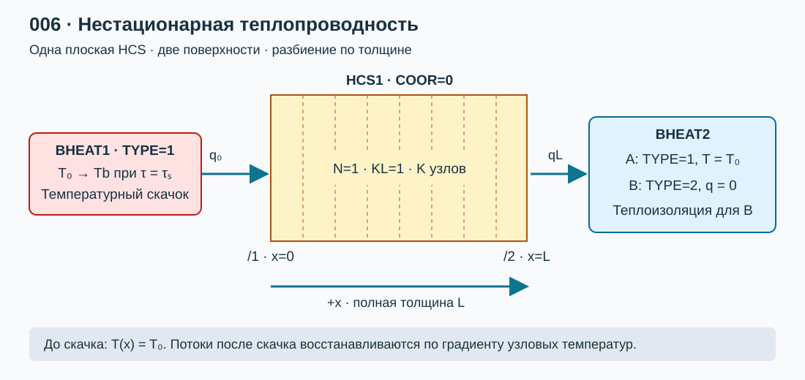
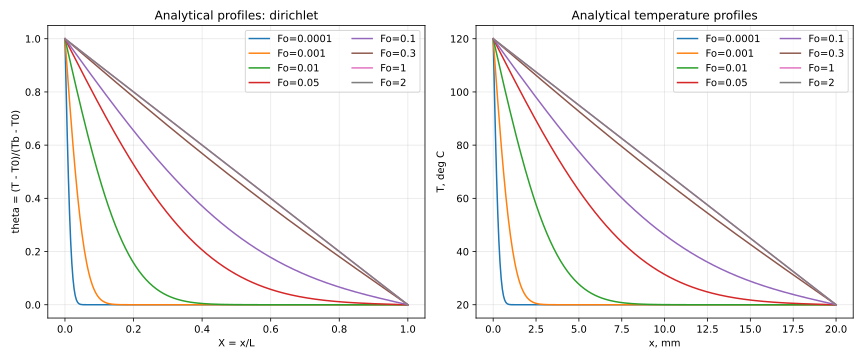
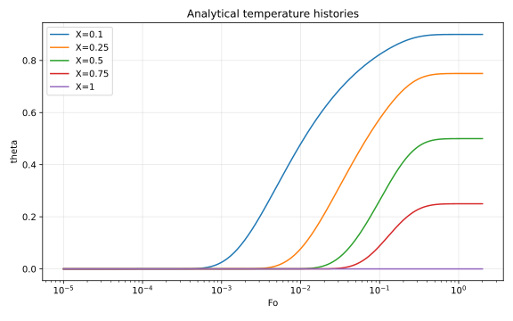
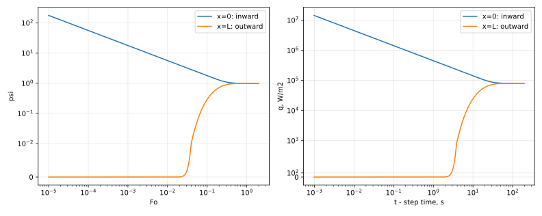

# Лабораторная работа №6. Нестационарная теплопроводность в плоской стенке

## 1. Цель работы

Собрать в КОРСАР расчетную схему из **HCS и BHEAT** для исследования прогрева однородной плоской стенки после скачка температуры на одной поверхности. Получить температурные профили, зависимости температуры и теплового потока от времени, сравнить их с аналитическим решением. Исследовать влияние разбиения по толщине и шага интегрирования отдельно для температуры и потока.

### Навыки, приобретаемые по результатам выполнения работы

- Задание плоской HCS, постоянных свойств материала и граничных условий первого и второго рода.
- Согласование равномерного начального поля со скачком температуры поверхности.
- Переход к безразмерным температуре, координате, времени и плотности теплового потока.
- Расчет рядов Фурье и обработка выгрузки КОРСАР средствами Python.
- Проверка пространственной и временной сходимости, точности восстановления градиента и энергетического баланса.

## 2. Описание постановки задачи

### 2.1. Два варианта граничных условий

Рассматривается неограниченная в двух направлениях пластина конечной **полной толщины** $L$. Координата $x$ отсчитывается от нагреваемой поверхности: $0\le x\le L$. Материал однородный, свойства постоянны, внутренние источники и фазовые переходы отсутствуют. До скачка температура всей стенки равна $T_0$.

**Вариант A — основной:** после скачка $T(0,t)=T_b$, а $T(L,t)=T_0$. На обеих поверхностях заданы условия первого рода. В установившемся состоянии формируется линейное поле температуры и ненулевой сквозной поток.

**Вариант B — по Пеховичу:** $T(0,t)=T_b$, а вторая поверхность теплоизолирована, $\partial T/\partial x|_{L}=0$. Это условия первого и второго рода. При длительном нагреве вся стенка достигает $T_b$, а поток затухает до нуля.

В предоставленном файле [\[2\]](#ref-pehovich) **задача №16 находится на печатных с. 197–198 (страницы файла 195–196)**. На печатной с. 199 начинается №17 с другим начальным полем. В №16 начальная температура равномерна, одна поверхность имеет заданную температуру, другая теплоизолирована. Поэтому точное воспроизведение №16 выполняется вариантом B; требование условий первого рода на обеих границах — вариантом A. Числовые параметры ниже назначены для учебной работы, а не заимствованы из задачи №16.

Нодализация представлена на [рисунке 1](#fig-nodal).

<a id="fig-nodal"></a>



*[Рисунок 1 — Плоская стенка: температурный скачок слева, заданная температура или теплоизоляция справа](./pic/nodal.svg).*

### 2.2. Исходные данные

| Параметр | Значение |
|---|---:|
| Полная толщина $L$ | 0,020 м |
| Площадь каждой поверхности $A$ | 1,0 м² |
| Теплопроводность $\lambda$ | 16 Вт/(м·К) |
| Плотность $\rho$ | 7800 кг/м³ |
| Удельная теплоемкость $c$ | 500 Дж/(кг·К) |
| Начальная температура $T_0$ | 20 °C = 293,15 К |
| Температура нагреваемой поверхности $T_b$ после скачка | 120 °C = 393,15 К |
| Время скачка по часам КОРСАР $\tau_s$ | 1,0 с |
| Время после скачка | $t=\tau-\tau_s$ |
| Основные моменты сравнения | $Fo=10^{-4};10^{-3};0,01;0,05;0,1;0,3;1;2$ |
| Контрольные координаты | $X=0,1;0,25;0,5;0,75;1$ |

Материал — условная сталь с постоянными свойствами. Для проверки аналитического решения не вводить зависимости свойств от температуры. Базовая конфигурация скрипта сохранена в [wall_config.json](./task/wall_config.json).

### 2.3. Математическая модель

Уравнение теплопроводности и температуропроводность определяются [формулой (1)](#eq-heat):

<a id="eq-heat"></a>

$$\rho c\frac{\partial T}{\partial t}=\lambda\frac{\partial^2T}{\partial x^2},\qquad a=\frac{\lambda}{\rho c}.\qquad(1)$$

Начальное и граничные условия записываются в [формуле (2)](#eq-bc):

<a id="eq-bc"></a>

$$T(x,0^-)=T_0;\quad T(0,t)=T_b\ (t>0);\quad
\begin{cases}T(L,t)=T_0,&\text{A},\\ \partial T/\partial x|_{L}=0,&\text{B}.\end{cases}\qquad(2)$$

В точке $(x,t)=(0,0)$ начальное и новое граничное условия несовместимы: это заданный физический скачок. Не требовать непрерывности температуры поверхности во времени в этой точке. Внутри стенки начальное поле остается равномерным в пределе $t\to0^+$.

Ввести безразмерные величины по [формуле (3)](#eq-dimensionless):

<a id="eq-dimensionless"></a>

$$X=\frac{x}{L},\quad Fo=\frac{at}{L^2},\quad
\theta=\frac{T-T_0}{T_b-T_0},\quad
q_x=-\lambda\frac{\partial T}{\partial x},\quad
\psi=\frac{q_xL}{\lambda(T_b-T_0)}=-\frac{\partial\theta}{\partial X}.\qquad(3)$$

$q_x$ — **плотность** потока, Вт/м², положительная в направлении $+x$. Полная мощность $\dot Q=Aq_x$, Вт. На левой границе положительный $q_x$ направлен внутрь стенки, на правой — наружу. Для базовых данных $a=4,102564\cdot10^{-6}$ м²/с, $L^2/a=97,5$ с и масштаб потока $\lambda(T_b-T_0)/L=80000$ Вт/м². Сравнение заканчивается при времени КОРСАР $\tau=196$ с. В Fo используется полная толщина $L$, а не ее половина.

### 2.4. Аналитическое решение

Для варианта A выделить стационарную часть $1-X$ и разложить остаток по синусам. Метод разделения переменных и приведения неоднородных условий к однородным изложен в [\[3\]](#ref-mit), [\[4\]](#ref-brown). Для наших условий получаем [формулу (4)](#eq-dd):

<a id="eq-dd"></a>

$$\theta_A(X,Fo)=1-X-\frac{2}{\pi}\sum_{n=1}^{\infty}
\frac{\sin(n\pi X)}{n}\exp(-n^2\pi^2Fo).\qquad(4)$$

Градиент и потоки определяются дифференцированием [формулы (4)](#eq-dd) при $Fo>0$:

<a id="eq-dd-flux"></a>

$$\psi_A(X,Fo)=1+2\sum_{n=1}^{\infty}\cos(n\pi X)\exp(-n^2\pi^2Fo),\quad
q_x=\frac{\lambda(T_b-T_0)}{L}\psi_A.\qquad(5)$$

Для варианта B задача №16 [\[2\]](#ref-pehovich) дает [формулу (6)](#eq-dn), записанную в принятой здесь нормировке:

<a id="eq-dn"></a>

$$\mu_n=(n-\tfrac12)\pi,\quad
\theta_B=1-2\sum_{n=1}^{\infty}\frac{\sin(\mu_nX)}{\mu_n}e^{-\mu_n^2Fo},\quad
\psi_B=2\sum_{n=1}^{\infty}\cos(\mu_nX)e^{-\mu_n^2Fo}.\qquad(6)$$

У Пеховича параметр температуры $\Theta=(T-T_b)/(T_0-T_b)=1-\theta$. Поэтому перед наложением на график 16-1 преобразовать нормировку. Параметр градиента $G$ из задачи №16 совпадает с нашим $\psi$. Для проверки графиков 16-1 и 16-3 использовать **только вариант B**.

Средняя температура для контроля накопленной энергии вычисляется по [формуле (7)](#eq-mean):

<a id="eq-mean"></a>

$$\bar\theta_A=\frac12-\frac4{\pi^2}\sum_{n=1,3,5,\ldots}\frac{e^{-n^2\pi^2Fo}}{n^2},\qquad
\bar\theta_B=1-2\sum_{n=1}^{\infty}\frac{e^{-\mu_n^2Fo}}{\mu_n^2}.\qquad(7)$$

При малом времени поток нагреваемой поверхности имеет особенность:

<a id="eq-early"></a>

$$q_x(0,t)\sim\frac{\lambda(T_b-T_0)}{\sqrt{\pi at}},\quad
\psi(0,Fo)\sim\frac1{\sqrt{\pi Fo}},\quad t\to0^+.\qquad(8)$$

Поток при $t=0^+$ бесконечен. Конечный максимум в численной модели зависит от сетки и шага; его нельзя сравнивать с «точным пиком». Сравнивать поток при одинаковых **положительных** временах. Для малых Fo скрипт использует эквивалентное представление через erfc и отраженные источники, устраняющее вычитание близких чисел у холодной поверхности. Оно сверяется с рядами Фурье командой `--self-check`. Число членов зависит от Fo и допуска, а не задано одним малым числом для всех времен.

В установившемся режиме A: $\theta=1-X$, $\psi=1$; в режиме B: $\theta=1$, $\psi=0$. Эти пределы и [асимптотика (8)](#eq-early) являются обязательными проверками скрипта.

### 2.5. Задание HCS и BHEAT

Использовать разделы 2.3.16 и 2.3.20 руководства [\[1\]](#ref-korsar). Гидравлический канал CH в этой постановке не нужен. Тепловые связи:

```text
HCS1(1)/1 - BHEAT1;
HCS1(1)/2 - BHEAT2;
```

| Элемент / ключ | Задание |
|---|---|
| HCS1: `COOR=0`, `TYPE=0` | Плоская геометрия, одномерная теплопроводность по толщине |
| HCS1: `N=1` | Одна ячейка вдоль стенки; N не определяет разбиение по толщине |
| HCS1: `KL=1` | Один материал |
| HCS1: `K` | Число узлов по толщине, включая поверхности; в данном руководстве допустимо 3–50 |
| HCS1: `XL`, `X` | Границы слоя 0 и L; координаты K узлов от 0 до L включительно |
| HCS1: `B=1`, `DFZ(1)=1` | Ширина и длина по 1 м; площадь каждой поверхности 1 м² |
| HCS1: `NL=1`, `LAM=16` | Постоянная теплопроводность |
| HCS1: `NC=1`, `CR=3900000` | Постоянное произведение $\rho c$, Дж/(м³·К), а не только теплоемкость c |
| HCS1: `QX=0`, `QZ=0` | Внутреннее энерговыделение отсутствует |
| BHEAT1: `TYPE=1` | Температура слева; до скачка 293,15 К, после 393,15 К |
| BHEAT2 для A: `TYPE=1` | Температура справа 293,15 К на всем интервале |
| BHEAT2 для B: `TYPE=2` | Нулевой поток на правой поверхности |

Примеры фрагментов DATA (не самостоятельная зона задания):

```text
DATA BHEAT1;
  TYPE=1; BCOND=293.15,0.;
END
DATA BHEAT2;          ! variant A
  TYPE=1; BCOND=293.15,0.;
END
! variant B instead: TYPE=2; BCOND=0.,0.;
```

Оба компонента `BCOND` должны быть заданы, хотя при `TYPE=1` используется только первый. Температуры задаются в К. Для постоянных свойств отключить переопределение материала через `TLAM`, `THC`, `TRO`; остальные обязательные ключи и размерности массивов заполнить по руководству. Проверить фактические площади `DF`, координаты `X`, температуры `T(K,1)` и `TW`.

Чтобы не получить при инициализации линейное поле вместо равномерного, первоначально держать обе стороны при $T_0$. В варианте B поле HCS инициализируется по левой температурной границе; все узлы также должны иметь $T_0$. Сохранить профиль до скачка как проверку. В момент $\tau_s=1$ с изменить `BCOND.BHEAT1(1)=393.15` процедурой EVENT и удерживать это значение далее. **Скачок должен совпадать с границей шага интегрирования.** Указать фактическое время срабатывания; не заменять скачок линейной интерполяцией по времени. Не включать ускорение стационарного решения (`ACCEL_STAT=0`); свойства и геометрию при событии не изменять.

### 2.6. Восстановление теплового потока

**При связи с BHEAT первого рода поле QW на соответствующей поверхности HCS не рассчитывается** (таблица 33, с. 83 руководства [\[1\]](#ref-korsar)). Поэтому вывести все узловые температуры и вычислять поток по градиенту. Не выдавать нулевое или служебное QW за физический поток.

Для равномерной сетки с шагом $\Delta x=L/(K-1)$ использовать односторонние формулы второго порядка [формулы (9)](#eq-gradient); индексы ниже начинаются с 0, а в КОРСАР — с 1:

<a id="eq-gradient"></a>

$$q_0\approx-\lambda\frac{-3T_0^{node}+4T_1^{node}-T_2^{node}}{2\Delta x},\qquad
q_L\approx-\lambda\frac{3T_{K-1}^{node}-4T_{K-2}^{node}+T_{K-3}^{node}}{2\Delta x}.\qquad(9)$$

Скрипт поддерживает и неравномерные координаты через трехточечную формулу `numpy.gradient(..., edge_order=2)`. В CSV дополнительно записывается поток по двухточечной формуле первого порядка. Для варианта B вычисленный градиент справа сравнивать с нулем; не подменять полученное значение принудительно нулевым.

Разделить две составляющие: ошибку температурного поля КОРСАР и ошибку восстановления производной. Для этого применить ту же трехточечную формулу к **аналитическим температурам в узлах выбранной сетки** и сравнить с точной [формулой (5)](#eq-dd-flux) либо [(6)](#eq-dn). Скрипт сохраняет эту оценку как `epsi_recovery_left/right`.

Проверка энергии выполняется по [формуле (10)](#eq-energy):

<a id="eq-energy"></a>

$$E(t)=\rho cA\int_0^L(T-T_0)\,dx
=\rho cAL(T_b-T_0)\bar\theta,\qquad
E(t_2)-E(t_1)=A\int_{t_1}^{t_2}[q_0(t)-q_L(t)]\,dt.\qquad(10)$$

Для дискретных данных брать $t_1>0$: трапеция с бесконечным начальным потоком неприменима. Скрипт записывает интервальную невязку энергии между соседними положительными временами. Она включает ошибки восстановления потока, пространственной и временной квадратуры, поэтому зависит также от частоты записи результатов.

### 2.7. План расчетов и исследование сходимости

1. Собрать вариант A, проверить одинаковую температуру всех узлов до скачка, правильность времени события и обе граничные температуры после него.
2. Для базового варианта построить профили $T(x,t)$ и $\theta(X,Fo)$, зависимости $\theta(Fo)$ в контрольных координатах и потоки на обеих поверхностях. Для координат между узлами указать способ пространственной интерполяции. Аналитику вычислять при действительных координатах и временах выгрузки.
3. Выполнить матрицу ниже для A. Повторить для B, сопоставить характерные профили и градиенты с задачей №16. Не смешивать варианты в одном файле списка расчетов.
4. Для пространственной сходимости менять K при одинаковом малом ограничении шага времени; для временной — менять шаг при фиксированном K. Совместное одновременное сгущение не позволяет разделить ошибки.
5. Если ошибка перестала уменьшаться при сгущении одного параметра, уменьшить второй. Для наиболее подробной сетки добавить шаг $\Delta Fo_{max}=0,000016$ и проверить, что выводы о пространственной сходимости сохраняются.

| Параметр | Значения |
|---|---|
| Узлы по толщине K | 5, 9, 17, 33, 49 |
| Число интервалов K−1 | 4, 8, 16, 32, 48 |
| $\Delta Fo_{max}=a\Delta\tau_{max}/L^2$ | 0,01; 0,002; 0,0004; 0,00008 |
| Соответствующий `DT_MAX`, с | 0,975; 0,195; 0,039; 0,0078 |
| Дополнительное уточнение `DT_MAX`, с | 0,00156 |
| Общий интервал итоговой оценки | $0,01\le Fo\le2$ |

Это 20 расчетов на вариант до дополнительного уточнения. Максимум K ограничен руководством, поэтому не назначать K=65 или 129 без проверки возможностей установленной версии. Сохранять толщину, площадь и физические свойства при изменении K.

Записывать результаты на общей временной сетке и отдельно обеспечить ранние точки $Fo=10^{-4},10^{-3}$. Если выбранное ограничение шага не разрешает ранний момент, выполнить отдельный ранний расчет с меньшим шагом; не интерполировать через скачок. Для потоков требуются более частый вывод и более подробная пространственная сетка, чем для температуры в середине стенки. `DT_OUT` не равен шагу интегрирования. При адаптивном выборе шага записать диапазон фактически принятых шагов и объяснить, почему изменение `DT_MAX` могло не изменить результат.

Оценки ошибок задать по [формуле (11)](#eq-errors):

<a id="eq-errors"></a>

$$e_T(Fo)=\max_j|\theta_{К,j}-\theta_{ан}(X_j,Fo)|,\quad
e_q(Fo)=\frac{|q_{К}-q_{ан}|}{\lambda|T_b-T_0|/L}=|\psi_{К}-\psi_{ан}|.\qquad(11)$$

Ошибку потока оценивать раздельно для обеих сторон. Нормировка на постоянный масштаб корректна и при близком к нулю потоке справа; деление на текущий почти нулевой аналитический поток не использовать. Для температуры скрипт также вычисляет норму $L_2$ по толщине. Итоговые максимумы сравнивать на одинаковых временах и интервале Fo; ранний участок обсуждать отдельно. Учебный ориентир — $e_T<0,01$ и $e_q<0,05$ на итоговом интервале с подтвержденным уменьшением ошибок. Если он не достигнут, привести фактические ошибки и причину, а не объявлять наиболее подробную сетку точной.

Масштаб прогретого слоя порядка $\sqrt{at}$. Объяснить, почему при $\Delta x\gtrsim\sqrt{at}$ поток плохо разрешен. Параметр $a\Delta\tau/\Delta x^2$ полезен для анализа, но условие устойчивости явной схемы нельзя автоматически приписывать алгоритму КОРСАР.

## 3. Требуемые результаты

- Расчетная схема [рисунка 1](#fig-nodal), таблица ключей HCS/BHEAT, исходный профиль и проверка граничных условий.
- Размерные профили температуры и сравнение $\theta(X,Fo)$ с [решениями (4)](#eq-dd), [(6)](#eq-dn); временные зависимости $\theta(Fo)$ в заданных точках.
- Плотность потока, Вт/м², и мощность, Вт, на обеих границах; безразмерные потоки, проверка [асимптотики (8)](#eq-early) и стационарных пределов.
- Сравнение варианта B с графиками 16-1 и 16-3 Пеховича после преобразования нормировки; минимум пять считываемых точек с оценкой точности считывания.
- Сводная таблица сходимости по K и шагу; ошибки температуры, потоков и восстановления градиента; проверка [баланса (10)](#eq-energy).
- Вывод о достаточном разбиении и шаге **отдельно для температуры и потока**, а также о достоверности ранних результатов.

Для ориентира приведены аналитические рисунки варианта A, полученные поставляемым скриптом. Это **аналитика, не результаты КОРСАР**. Собственные сравнения оформить аналогично [рисункам 2](#fig-profiles), [3](#fig-histories) и [4](#fig-flux).

<a id="fig-profiles"></a>



*[Рисунок 2 — Аналитические профили температуры при разных Fo](./pic/temperature_profiles.svg).*

<a id="fig-histories"></a>



*[Рисунок 3 — Зависимости безразмерной температуры от Fo в контрольных точках](./pic/temperature_histories.svg).*

<a id="fig-flux"></a>



*[Рисунок 4 — Плотность потока во времени и безразмерные потоки](./pic/heat_flux.svg).*

На рисунке 4 применена логарифмическая шкала времени и симметрично-логарифмическая шкала потока с линейной областью около нуля: так различимы и ранний большой поток, и поток на противоположной границе.

## 4. Формат отчетности и Python-обработка

Представить `task/kordat`, `task/kutdat`, настройки всех вариантов, скрипт обработки, отчет `report.md`, итоговые таблицы и рисунки. За основу оформления принять [пример 000](../000_simple_hr/readme.md) и его [шаблон отчета](../000_simple_hr/report_template.md). Бинарные результаты в репозиторий не добавлять. Расчетный вариант КОРСАР составляет обучающийся; ниже поставляется готовый аналитический и обрабатывающий скрипт.

### 4.1. Запуск аналитического решения

Скрипт [analyze_wall.py](./task/analyze_wall.py) использует Python 3.8+, NumPy и Matplotlib; зависимости перечислены в [requirements.txt](./task/requirements.txt). Если пакеты уже установлены, установка не требуется. Команды из каталога лабораторной работы:

```console
python -m pip install -r task/requirements.txt
python task/analyze_wall.py --self-check
python task/analyze_wall.py --config task/wall_config.json --out result/analytical_A
python task/analyze_wall.py --config task/wall_config.json --boundary insulated --out result/analytical_B
```

Проверка `--self-check` сопоставляет независимые представления через ряды и erfc, проверяет стационарные пределы, энергетический баланс и раннюю асимптотику. Для изменения свойств редактировать JSON и точно такие же значения задавать в КОРСАР. Файл `config_used.json` в результатах фиксирует использованные параметры.

### 4.2. Формат данных КОРСАР

Экспортировать таблицу с заголовком **`time_s,x_m,T_K`**: одна строка на узел в каждый момент времени. Разделитель — запятая, десятичный знак — точка, кодировка UTF-8. `time_s` содержит абсолютное время КОРСАР, включая задержку до скачка; скрипт вычитает `step_time_s`. `x_m` — фактическая координата узла от левой поверхности, `T_K` — температура в К.

Экспорт должен содержать все узлы, в том числе поверхности x=0 и x=L. Число и координаты узлов внутри одного файла не меняются. Повторяющиеся пары время–координата и отсутствующие поверхности вызывают ошибку. Бинарный `korres` скрипт напрямую не читает: сначала выполнить вывод температур средствами `kutdat`/kutil и привести таблицу к указанному формату. Не переименовывать столбцы времени или температуры без пересчета единиц.

Скопировать [cases_template.json](./task/cases_template.json) в `task/cases_A.json`, перечислить полученные CSV, подписи и фактические настройки `dt_max_s`. Пути CSV считаются от папки JSON. Файлы CSV, перечисленные в шаблоне, появятся после расчетов — фиктивные результаты не включены. Для B подготовить отдельный список.

```console
python task/analyze_wall.py --config task/wall_config.json --cases task/cases_A.json --fo-min 0.01 --out result/analysis_A
python task/analyze_wall.py --config task/wall_config.json --boundary insulated --cases task/cases_B.json --fo-min 0.01 --out result/analysis_B
```

Основные выходные файлы:

| Файл | Содержание |
|---|---|
| `analytical_profiles.csv`, `analytical_history.csv` | Аналитические температуры, потоки, мощности и средняя температура |
| `temperature_profiles.svg`, `temperature_histories.svg`, `heat_flux.svg` | Аналитические рисунки |
| `comparison_profiles_XX.svg` | Профили КОРСАР и аналитики в ближайшие **фактически записанные** моменты; их Fo подписаны |
| `comparison_histories_XX.svg` | Зависимости температуры от Fo; в точках между узлами используется линейная пространственная интерполяция |
| `comparison_flux_XX.svg` | Сопоставление потоков на обеих поверхностях |
| `metrics.csv` | Ошибки и баланс в каждый положительный момент, потоки первого/второго порядка, ошибка восстановления производной |
| `convergence_summary.csv`, `convergence.svg` | Максимумы ошибок на Fo ≥ `--fo-min`, серии по K и шагу времени |
| `errors_vs_fo.svg`, `comparison_profiles.csv` | Временные зависимости ошибок и числовое сравнение профилей |

В `metrics.csv` поле `interval_balance_J` для первой положительной записи пустое по смыслу (`NaN`): предыдущего положительного времени нет. Для итогового сравнения проверить `Fo_first`, `Fo_last` и `samples` в сводке; различающиеся интервалы или частота записи могут смещать максимумы ошибок. Графики сходимости появляются только для серий, в которых изменяется один параметр при фиксированном втором.

## 5. Список литературы

1. <a id="ref-korsar"></a> **КОРСАР/В3. Руководство пользователя.** [Локальный PDF](../files/distr/um_v3_ru.pdf). §2.3.16 HCS, с. 71–88; таблица 33: K, N, COOR, CR, X, T, QW; §2.3.20 BHEAT, с. 96–98; таблица 41: TYPE и BCOND. [С. 83: ограничения QW](../files/distr/um_v3_ru.pdf#page=83), [с. 98: задание BCOND](../files/distr/um_v3_ru.pdf#page=98).
2. <a id="ref-pehovich"></a> **Пехович А. И., Жидких В. М. Расчеты теплового режима твердых тел.** 2-е изд., перераб. и доп. Л.: Энергия, 1976. 352 с. [Локальный DjVu](../files/data/006/1976_Pehovich_Raschet_tverdogo_tela.djvu). Раздел «Неограниченная пластина», задача №16, печатные с. 197–198, страницы файла 195–196: температура, средняя температура и градиент при температурном скачке и теплоизоляции второй поверхности. Ссылку на нужную страницу в программе просмотра выбирать с учетом этого смещения.
3. <a id="ref-mit"></a> **Orloff J. Differential Equations, ES.1803. Solutions Day 53, Topic 26: PDEs, 26 April 2024.** MIT OpenCourseWare. [Учебный материал](https://ocw.mit.edu/courses/es-1803-differential-equations-spring-2024/mites_1803_s24_day53-problems-qa.pdf). Задача 5: приведение неоднородных температурных граничных условий к однородным выделением стационарного решения. Формула варианта A в настоящей работе выведена этим методом для наших начальных и граничных условий.
4. <a id="ref-brown"></a> **Dobrushkin V. A. Boundary Value Problems for Heat Equation.** Brown University, учебные материалы. [Раздел о решении уравнения теплопроводности](https://www.cfm.brown.edu/people/dobrush/am34/Matlab/ch6/bheat.html). Разделение переменных и разложение по собственным функциям; используются как обоснование аналитического подхода.

## 6. Контрольные вопросы

1. Чем различаются условия первого, второго и третьего рода? Как они задаются в BHEAT?
2. Почему задача №16 Пеховича и вариант с заданной температурой на обеих поверхностях имеют разные стационарные пределы?
3. Чем отличаются N, KL и K у HCS? Сколько интервалов по толщине соответствует K узлам?
4. Почему в CR задается произведение плотности на теплоемкость? Как проверить его единицы?
5. Почему нельзя одновременно задать равномерное начальное поле и считать новую температуру поверхности действовавшей до начала расчета?
6. Что означают Fo, X, θ и ψ? Как меняются размерные кривые при удвоении толщины при сохранении Fo?
7. Как связаны нормировка Пеховича Θ и нормировка θ этой работы?
8. Почему поток при идеальном скачке неограниченно возрастает при t→0? Почему сравнение численных максимумов на разных сетках некорректно?
9. Почему ряд температуры может казаться сошедшимся, а ряд ее производной еще давать заметную ошибку?
10. Почему при BHEAT первого рода QW нельзя использовать как рассчитанный поток?
11. Как отделить ошибку восстановления градиента от ошибки самого температурного поля?
12. Почему ошибка потока обычно чувствительнее к сетке, чем температура в середине стенки?
13. Как раздельно проверить пространственную и временную сходимость? Почему ограничение DT_MAX не всегда равно фактическому шагу?
14. Чем различаются ошибка интегрирования и ошибка из-за редкой записи результатов?
15. Как проверить энергетический баланс при сингулярном начальном потоке?
16. В каких случаях перестанут действовать аналитические решения этой работы: переменные свойства, фазовый переход, внутреннее энерговыделение, многослойная стенка?

## Сокращения и обозначения

HCS — теплопроводящая конструкция; BHEAT — заданное граничное условие; L — полная толщина, м; A — площадь поверхности, м²; K — число узлов по толщине; λ — теплопроводность, Вт/(м·К); ρc — объемная теплоемкость, Дж/(м³·К); a — температуропроводность, м²/с; τ — время КОРСАР, с; t — время после скачка, с; q — плотность потока, Вт/м²; $\dot Q$ — мощность, Вт; E — накопленная энергия, Дж; Fo — число Фурье.
