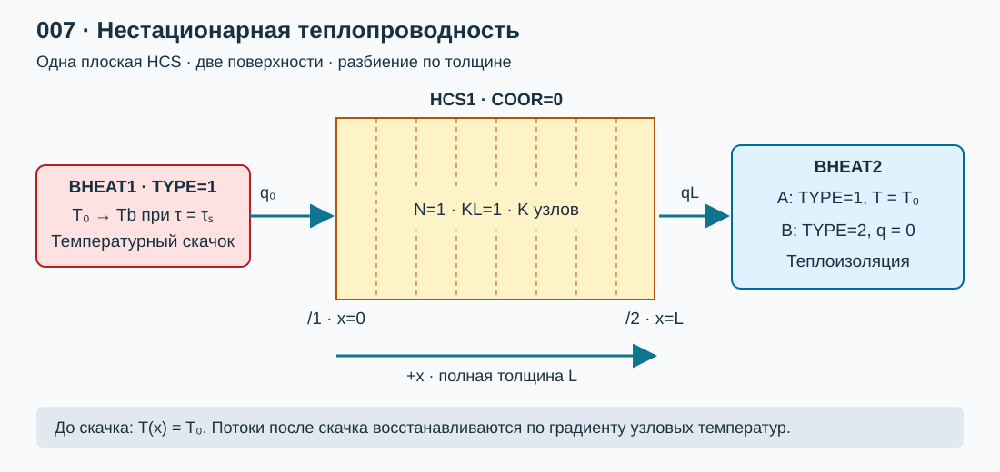

# Лабораторная работа №7. Нестационарная теплопроводность в плоской стенке

## 1. Цель работы

Собрать в КОРСАР расчетную схему из **HCS и BHEAT** для исследования прогрева однородной плоской стенки после скачка температуры на одной из поверхностей. Получить температурные профили, зависимости температуры и теплового потока от источника тепла от времени, сравнить их с аналитическим решением. Исследовать влияние разбиения по толщине и шага интегрирования по времени.

### Навыки, приобретаемые по результатам выполнения работы

- Задание плоской HCS, постоянных свойств материала и граничных условий первого и второго рода.
- Решение нестационарной тепловой задачи в безразмерном виде.
- Верификация получаемого численного решения.

## 2. Описание постановки задачи

### 2.1. Два варианта граничных условий

Рассматривается неограниченная в двух направлениях пластина конечной **полной толщины** $L$. Координата $x$ отсчитывается от нагреваемой поверхности: $0\le x\le L$. Материал однородный, свойства постоянны, внутренние источники и фазовые переходы отсутствуют. До скачка температура всей стенки равна $T_0$.

**Вариант A — основной:** после скачка $T(0,t)=T_b$, а $T(L,t)=T_0$. На обеих поверхностях заданы условия первого рода. В установившемся состоянии формируется линейное поле температуры и ненулевой сквозной поток.

**Вариант B — по Пеховичу:** $T(0,t)=T_b$, а вторая поверхность теплоизолирована, $\partial T/\partial x|_{L}=0$. Это условия первого и второго рода. При длительном нагреве вся стенка достигает $T_b$, а поток затухает до нуля.

Вариант нодализации представлен на [рисунке 1](#fig-nodal).

*[Рисунок 1 — Плоская стенка: температурный скачок слева, заданная температура или теплоизоляция справа](./pic/nodal.svg)*

### 2.2. Исходные данные

| Параметр | Значение |
|---|---:|
| Полная толщина $L$ | 0.020 м |
| Площадь каждой поверхности $A$ | 1.0 м² |
| Теплопроводность $\lambda$ | 16 Вт/(м·К) |
| Плотность $\rho$ | 7800 кг/м³ |
| Удельная теплоемкость $c$ | 500 Дж/(кг·К) |
| Начальная температура $T_0$ | 20 °C = 293.15 К |
| Температура нагреваемой поверхности $T_b$ после скачка | 120 °C = 393.15 К |
| Основные моменты сравнения | $Fo=10^{-4};10^{-3};0.01;0.05;0.1;0.3;1;2$ |
| Контрольные координаты | $X=0.1;0.25;0.5;0.75;1$ |

### 2.3. Математическая модель

Уравнение теплопроводности и температуропроводность определяются [формулой (1)](#eq-heat):

$$\rho c\frac{\partial T}{\partial t}=\lambda\frac{\partial^2T}{\partial x^2},\qquad a=\frac{\lambda}{\rho c}.\qquad(1)$$

Начальное и граничные условия записываются в [формуле (2)](#eq-bc):

$$T(x,0^-)=T_0;\quad T(0,t)=T_b\ (t>0);\quad
\begin{cases}T(L,t)=T_0,&\text{A},\\ \partial T/\partial x|_{L}=0,&\text{B}.\end{cases}\qquad(2)$$

Безразмерные величины по [формуле (3)](#eq-dimensionless):

$$X=\frac{x}{L},\quad Fo=\frac{at}{L^2},\quad
\theta=\frac{T-T_0}{T_b-T_0},\quad
q_x=-\lambda\frac{\partial T}{\partial x},\quad
\psi=\frac{q_xL}{\lambda(T_b-T_0)}=-\frac{\partial\theta}{\partial X}.\qquad(3)$$

$q_x$ — **плотность** потока, Вт/м², положительная в направлении $+x$. Полная мощность $\dot Q=Aq_x$, Вт. На левой границе положительный $q_x$ направлен внутрь стенки, на правой — наружу.

### 2.4. Аналитическое решение

Для **варианта A** выделить стационарную часть $1-X$ и разложить остаток по синусам. Метод разделения переменных и приведения неоднородных условий к однородным изложен в [\[3\]](#ref-mit), [\[4\]](#ref-brown). Для наших условий получаем [формулу (4)](#eq-dd):

$$\theta_A(X,Fo)=1-X-\frac{2}{\pi}\sum_{n=1}^{\infty}
\frac{\sin(n\pi X)}{n}\exp(-n^2\pi^2Fo).\qquad(4)$$

Градиент и потоки определяются дифференцированием [формулы (4)](#eq-dd) при $Fo>0$:

$$\psi_A(X,Fo)=1+2\sum_{n=1}^{\infty}\cos(n\pi X)\exp(-n^2\pi^2Fo),\quad
q_x=\frac{\lambda(T_b-T_0)}{L}\psi_A.\qquad(5)$$

Для **варианта B** задача №16 [\[2\]](#ref-pehovich) дает [формулу (6)](#eq-dn), записанную в принятой здесь нормировке:

$$\mu_n=(n-\tfrac12)\pi,\quad
\theta_B=1-2\sum_{n=1}^{\infty}\frac{\sin(\mu_nX)}{\mu_n}e^{-\mu_n^2Fo},\quad
\psi_B=2\sum_{n=1}^{\infty}\cos(\mu_nX)e^{-\mu_n^2Fo}.\qquad(6)$$

В установившемся **режиме A**: $\theta=1-X$, $\psi=1$.  
В **режиме B**: $\theta=1$, $\psi=0$.  

Чтобы не получить при инициализации линейное поле вместо равномерного, первоначально держать обе стороны при $T_0$. В варианте B поле HCS инициализируется по левой температурной границе; все узлы также должны иметь $T_0$. Сохранить профиль до скачка как проверку. В произвольный момент $\tau_s$ изменить `BCOND.BHEAT1(1)=393.15` процедурой EVENT и удерживать это значение далее. **Скачок должен совпадать с границей шага интегрирования.** 

### 2.5. План расчетов и исследование сходимости

1. Собрать вариант A, проверить одинаковую температуру всех узлов до скачка, правильность времени события и обе граничные температуры после него.
2. Для базового варианта построить профили $T(x,t)$ и $\theta(X,Fo)$, зависимости $\theta(Fo)$ в контрольных координатах и потоки на обеих поверхностях. Для координат между узлами указать способ пространственной интерполяции. Аналитику вычислять при действительных координатах и временах выгрузки.
3. Выполнить отдельные расчеты для вариантов А и В.
4. Для исследования влияния шага по толщине менять K при одинаковом малом ограничении шага времени; для исследования влияния временного шага временной — менять шаг при фиксированном K. Выполнить совместное изменение шага по времени и пространству, исходя из сохранения значения числа Fo расчетного слоя (между узлами).
5. Привести графики изменения решения задачи при исследовании сходимости

## 3. Требуемые результаты

- Размерные и безразмерные профили температуры и сравнение $\theta(X,Fo)$ с [решениями (4)](#eq-dd), [(6)](#eq-dn); временные зависимости $\theta(Fo)$ в заданных точках.
- Плотность потока, Вт/м², и мощность, Вт, на границе задания источника тепла; проверка стационарных режимов.
- Сравнение варианта B с аналитическими графиками 16-1 и 16-3 Пеховича после преобразования нормировки; минимум пять считываемых точек с оценкой точности считывания. 
- Скрипты обработки данных, получения аналитических решений и расчета отклонения численного решения по КОРСАР от аналитического.
- Сводная таблица сходимости по разбиению и временному шагу.
- Вывод о достаточном разбиении и шаге по времени

## 4. Формат отчетности и Python-обработка

Представить `task/kordat`, `task/kutdat`, настройки всех вариантов, скрипты обработки и аналитических решений, отчет `report.md`. За основу оформления принять [шаблон отчета](../000_simple_hr/report_template.md). Бинарные результаты в репозиторий не добавлять. Выслать преподавателю форк репозитория с выполненным заданием.

## 5. Список литературы

1.  **КОРСАР/В3. Руководство пользователя.**
2.  **Пехович А. И., Жидких В. М. Расчеты теплового режима твердых тел.** 2-е изд., перераб. и доп. Л.: Энергия, 1976. 352 с. 
3.  **Orloff J. Differential Equations, ES.1803. Solutions Day 53, Topic 26: PDEs, 26 April 2024.** MIT OpenCourseWare. [Учебный материал](https://ocw.mit.edu/courses/es-1803-differential-equations-spring-2024/mites_1803_s24_day53-problems-qa.pdf).
4.  **Dobrushkin V. A. Boundary Value Problems for Heat Equation.** Brown University, учебные материалы. [Раздел о решении уравнения теплопроводности](https://www.cfm.brown.edu/people/dobrush/am34/Matlab/ch6/bheat.html).

## 6. Контрольные вопросы

1. Чем различаются условия первого, второго и третьего рода? Как они задаются в BHEAT?
2. Почему задача №16 Пеховича и вариант с заданной температурой на обеих поверхностях имеют разные стационарные режимы?
3. Чем отличаются N, KL и K у HCS? За что отвечает каждый из ключей по смыслу?
4. Что означают Fo, X, θ и ψ? Зачем введены безразмерные координаты тепловой задачи?
5. Каким образом должно выполняться уточнение решения задачи при увеличении подробности сетки?

## Сокращения и обозначения

HCS — теплопроводящая конструкция; BHEAT — заданное граничное условие; L — полная толщина, м; A — площадь поверхности, м²; K — число узлов по толщине; λ — теплопроводность, Вт/(м·К); ρc — объемная теплоемкость, Дж/(м³·К); a — температуропроводность, м²/с; τ — время КОРСАР, с; t — время после скачка, с; q — плотность потока, Вт/м²; $\dot Q$ — мощность, Вт; E — накопленная энергия, Дж; Fo — число Фурье.
