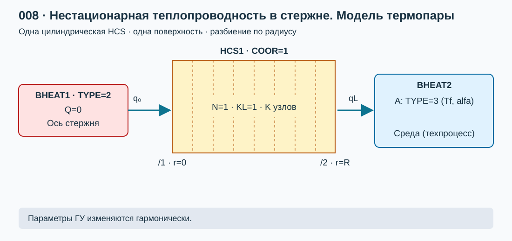

# Лабораторная работа №8. Нестационарная теплопроводность в полнотелом стержне. Модель термопары

## 1. Цель работы

Собрать в КОРСАР расчетную схему для исследования нестационарного теплового режима полнотелого стержня, моделирующего цилиндрическую термопару. Получить температурные профили для скачка температуры (аналитические и численные) по радиусу стержня во времени, сделать оценку постоянной времени термопары. По изменению гармонического сигнала построить АЧХ термопары, вычислить частоту среза по уровню 3 дБ.

### Навыки, приобретаемые по результатам выполнения работы

- Расчет цилиндрической HCS в нестационарном тепловом режиме
- Верификация получаемого численного решения
- Определение пригодности термопары для измерения быстропротекающих тепловых процессов

## 2. Описание постановки задачи

### 2.1. Два варианта граничных условий

Рассматривается нбесконечный по длине стенржень диаметра $D$. Координата $r$ отсчитывается от оси стержня: $0\le r\le R=\frac{D}{2}$. Материал однородный, свойства постоянны, внутренние источники и фазовые переходы отсутствуют. В нулевой момент времени температура всей стенки равна $T_0$. На наружной поверхности стержня заданы ГУ 3 рода (теплообмен с текучей средой).

Вариант нодализации представлен на [рисунке 1](#fig-nodal).

*[Рисунок 1 — Моедель термопары: полнотелый цилиндрический стержень](./pic/nodal.svg)*

### 2.2. Исходные данные

| Параметр | Значение |
|---|---:|
| Диаметр $D$ | 0.005 м |
| Теплопроводность $\lambda$ | 30 Вт/(м·К) |
| Плотность $\rho$ | 7800 кг/м³ |
| Удельная теплоемкость $c$ | 500 Дж/(кг·К) |
| Начальная температура $T_0$ | 20 °C = 293.15 К |
| Температура термометрируемой среды | 200 °C = 473.15 К |

### 2.3. Математическая модель и аналитическое решение

Для нахождения аналитического решения может быть взята задача №43 [\[2\]](#ref-pehovich), для которой приведены безразмерные решения для температурного поля и теплового потока на наружной поверхности цилиндра.

### 2.4. План расчетов и исследование сходимости

1. Рассчитать профили $\theta(\eta=r/R,Fo)$, в контрольных координатах, поток тепла на поверхности теплоотдачи аналитическим методом и с использованием кода КОРСАР при задании температурного скачка в граничном условии. Т.к. аналитическое решение представлено в виде бесконечного ряда предварительно оценить конечную сумму членов, достаточную для получения решения с заданной точностью (не хуже $\varepsilon_{\theta}=10^{-5}$). 
2. Найти при помощи расчетов в коде КОРСАР постоянную времени, АЧХ и ФЧХ термопары любым методом, например: 
   - задавая гармоническое граничное условие с различной частотой и измеряя отклик на оси термопары;  
   - при помощи аналитического сигнала.
3. Провести анализ сходимости по шагу разбиения и по временному шагу

## 3. Требуемые результаты

- Размерные и безразмерные профили температуры в заданных точках.
- Плотность потока, Вт/м², и мощность, Вт, на границе задания источника тепла; проверка стационарных режимов.
- Сравнение расчета по КОРСАР с аналитическими зависимостями.
- АЧХ и ФЧХ термопары, оценка частоты среза
- Скрипты обработки данных, получения аналитических решений и расчета отклонения численного решения по КОРСАР от аналитического.
- Сводная таблица сходимости по разбиению и временному шагу.

## 4. Формат отчетности и Python-обработка

Представить `task/kordat`, `task/kutdat`, настройки всех вариантов, скрипты обработки и аналитических решений, отчет `report.md`. За основу оформления принять [шаблон отчета](../000_simple_hr/report_template.md). Бинарные результаты в репозиторий не добавлять. Выслать преподавателю форк репозитория с выполненным заданием.

## 5. Список литературы

1.  **КОРСАР/В3. Руководство пользователя.**
2.  **Пехович А. И., Жидких В. М. Расчеты теплового режима твердых тел.** 2-е изд., перераб. и доп. Л.: Энергия, 1976. 352 с. 

## 6. Контрольные вопросы

1. Чем различаются условия первого, второго и третьего рода? Как они задаются в BHEAT?
2. Какие отличия (упрощения) могут быть критичны в данной задаче в плане реалистичности представления натурной термопары
3. Что такое АЧХ, ФЧХ и почему они могут иметь значение для исследований турбулентности?
4. Чем отличаются N, KL и K у HCS? За что отвечает каждый из ключей по смыслу?
5. Что означают Fo, Bi, θ ? Зачем введены безразмерные координаты тепловой задачи?
6. Каким образом должно выполняться уточнение решения задачи при увеличении подробности сетки?

## Сокращения и обозначения

АЯХ — амплитудно-частотная характеристика; дБ — децибелл; ФЧХ — фазо-частотная характеристика, HCS — теплопроводящая конструкция; BHEAT — заданное граничное условие; L — полная толщина, м; A — площадь поверхности, м²; K — число узлов по толщине; λ — теплопроводность, Вт/(м·К); ρc — объемная теплоемкость, Дж/(м³·К); a — температуропроводность, м²/с; τ — время КОРСАР, с; t — время после скачка, с; q — плотность потока, Вт/м²; $\dot Q$ — мощность, Вт; E — накопленная энергия, Дж; Fo — число Фурье.
