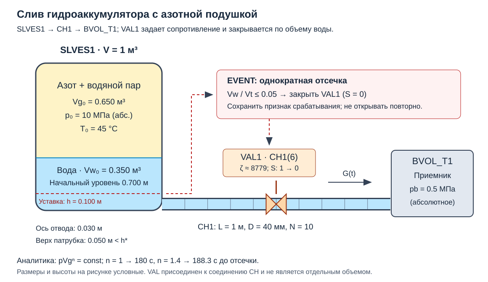

# Лабораторная работа №10. Слив гидроаккумулятора под давлением азотной подушки

## 1. Цель работы

Собрать в КОРСАР расчетную схему, моделирующую слив воды из гидроаккумулятора под давлением азотной подушки. Получить зависимости массового расхода воды и давления от времени. При снижении объема воды до 5% полного объема сосуда прекратить истечение закрытием VAL. Сравнить результаты с аналитическими зависимостями для изотермического и адиабатического расширения газовой подушки.

### Навыки, приобретаемые по результатам выполнения работы

- Задание SLVES в режиме гидроаккумулятора с азотом, начальным уровнем и температурой.
- Задание гидравлического сопротивления VAL и однократного закрытия по уровню в EVENT.
- Вывод модели слива из дифференциальных законов сохранения массы, импульса и энергии.
- Разделение влияния гидравлического сопротивления, теплообмена газовой подушки и численных настроек.

## 2. Описание постановки задачи

### 2.1. Расчетная схема и исходное состояние

Вертикальный цилиндрический сосуд частично заполнен водой. Над водой находится азотная подушка; начальное давление над уровнем $p_0=10$ МПа, начальная температура воды и газа $T_0=45$ °C. Через нижний патрубок вода поступает в сливной канал CH и далее в приемник BVOL_T с постоянным давлением $p_b=0.5$ МПа. Все давления **абсолютные**. В одном из соединений CH установлен VAL, который в открытом положении представляет постоянное сопротивление шайбы, а при достижении уставки уровня закрывается.

<a id="fig-nodal"></a>



*[Рисунок 1 — Гидроаккумулятор с азотной подушкой, ограничитель и приемник](./pic/nodal.svg)*

### 2.2. Исходные данные и подбор сопротивления

| Параметр | Значение |
|---|---:|
| Полный объем сосуда $V_t$ | 1.000 м³ |
| Высота сосуда $H$ | 2.000 м |
| Начальный объем воды $V_{w0}$ | 0.350 м³ |
| Начальный объем газовой подушки $V_{g0}$ | 0.650 м³ |
| Начальный уровень $h_0$ | 0.700 м |
| Объем воды при закрытии $V_{w*}$ | 0.050 м³ |
| Уровень при закрытии $h_*$ | 0.100 м |
| Объем газа при закрытии $V_{g*}$ | 0.950 м³ |
| Сливаемый объем воды | 0.300 м³ |
| Начальное давление над уровнем $p_0$ | $1$ МПа |
| Давление приемника $p_b$ | $0.5$ МПа |
| Начальные температуры воды и газа | 318.15 К |
| Температура жидкости BVOL_T | 318.15 К |
| Газовая постоянная азота $R_{N2}$ | 296.8 Дж/(кг·К) |
| Показатель адиабаты $\gamma$ | 1.4, постоянный |
| Длина CH $\ell$ | 1.000 м |
| Внутренний диаметр CH $D_c$ | 0.040 м |
| Основное разбиение CH | 10 ячеек |
| Полное эквивалентное сопротивление $\zeta_\Sigma$ | ~8780.|

### 2.3. Настройки SLVES, CH, BVOL_T и VAL

**Азотная подушка.** Использовать раздел 5 руководства [\[1\]](#ref-korsar). Для основной задачи выбрать `NGAS='H2O'` или `NGAS='H2O, N2'`в основной процедуре и ненулевой `XNG(3)` у SLVES — это специальный **режим гидроаккумулятора**.

Для теста постоянной массы азота можно задать нулевые начальные `XNF` и включить признак `'9'` в `NOPTION`, отключающий растворение и дегазацию (§5.2.2). Остальные необходимые признаки NOPTION сохранять.

В начальном парогазовом объеме задать азот с небольшой примесью водяного пара, соответствующей насыщению при 318.15 К. Начальное парциальное давление пара определить функцией свойств воды; ориентир — около 9.6 кПа. Тогда `XNG(3)` равен около 0.999; 

Исходное состояние подготовить при закрытом VAL: вода до него находится под давлением сосуда с гидростатической поправкой, после него — под давлением приемника; начальный расход нулевой. Началом $t=0$ считать открытие VAL. Если исходное состояние получено предварительным расчетом, зафиксировать фактические $p_0$, $V_{g0}$ и $T_0$ непосредственно перед открытием. Не допускать незаметного слива во время получения статики.

**Закрытие по уставке слития** произвести в процедуре EVENT за 1 сек.

### 2.4. Тепловые режимы и смысл сравнения

Построить две аналитические кривые: **I — изотерма, $n=1$**, и **A — адиабата, $n=\gamma=1.4$**. Основную модель SLVES сравнить с обеими кривыми. В ней давление определяется собственной моделью энергии и межфазного обмена.

В базовой схеме не подключать корпус HCS и внешние источники тепла. При этом теплообмен между водой и газом и испарение/конденсация на зеркале сохраняются: **отсутствие теплообмена через корпус не означает адиабатичности азотной подушки**. 

Для приближения к изотерме можно задать корпус сосуда (HCS, связанную с SLVES) со значением теплоемкости и начальной температуры, соответсвтующей массивной металлической стенке.

## 3. Вывод аналитических зависимостей из законов сохранения

### 3.1. Допущения и обозначения

Вода несжимаема, ее плотность постоянна; газ идеален, однороден по температуре и давлению, его масса постоянна. Испарение, растворение и унос азота в аналитике отсутствуют. Сосуд жесткий. Расход $q$ — объемный, м³/с; $G=\rho q$ — массовый, кг/с. Положительное направление — из сосуда в приемник. $p$ — давление над уровнем; $V_g+V_w=V_t$; $h=V_w/A_t$. Подвод тепла к газу обозначен $\dot Q_g$, чтобы не смешивать его с расходом.

### 3.2. Дифференциальный закон сохранения массы

Для жидкости локальное уравнение непрерывности:

<a id="eq-mass-local"></a>

$$\frac{\partial\rho}{\partial t}+\nabla\cdot(\rho\mathbf u)=0.\qquad(1)$$

Интегрируя по водяному объему сосуда с движущейся свободной поверхностью и единственным выходом, получаем $dM_w/dt=-G$. При постоянной плотности:

<a id="eq-mass"></a>

$$\frac{dV_w}{dt}=-q,\qquad \frac{dV_g}{dt}=q,\qquad \frac{dh}{dt}=-\frac{q}{A_t},\qquad V_g(0)=V_{g0}.\qquad(2)$$

Порог закрытия соответствует $V_{g*}=V_t-0.05V_t=0.95V_t$. Баланс слитой массы до отсечки:

$$\int_0^{t_*}G(t)\,dt=\rho(V_{w0}-0.05V_t)=297\;\text{кг}.\qquad(3)$$

Это масса на выходе **из сосуда**. Для интеграла на выходе из CH в КОРСАР дополнительно учитывать изменение запаса воды в самом канале.

### 3.3. Дифференциальный закон сохранения импульса

Локальное уравнение количества движения жидкости:

<a id="eq-momentum-local"></a>

$$\rho\left(\frac{\partial\mathbf u}{\partial t}+\mathbf u\cdot\nabla\mathbf u\right)=-\nabla p+\rho\mathbf g+\nabla\cdot\boldsymbol\tau.\qquad(4)$$

Интегрируем его вдоль тракта от сосуда к приемнику. В прямом канале постоянного сечения $u=q/A_c$. Интеграл локального ускорения дает инерционный перепад $\rho\ell\,dq/(A_cdt)$; конвективные ускорения и вязкое сопротивление учитываем в принятом эквивалентном коэффициенте потерь $\zeta_\Sigma$. Скоростью свободной поверхности пренебрегаем, поскольку $A_t\gg A_c$. Для приемника на отметке $z_p$:

<a id="eq-momentum"></a>

$$\frac{\rho\ell}{A_c}\frac{dq}{dt}=p-p_b+\rho g(h-z_p)-\frac{\rho\zeta_\Sigma(S)}{2A_c^2}q|q|.\qquad(5)$$

Для участка переменного сечения инерционный множитель заменяется на $\rho\int ds/A(s)$. Сопротивление $\zeta_\Sigma$ включает выбранные входные/выходные потери и относится к скорости $q/A_c$; если сравниваются статические давления прямо на выходном сечении, отдельно согласовать выходной скоростной напор. Нельзя одновременно включать его в КГС и добавлять повторно.

После короткого разгона при открытом VAL пренебрежем $dq/dt$. Гидростатическая добавка здесь не более $\rho g(h_0-z_p)\approx6.5$ кПа против начального перепада 9500 кПа. В основной аналитике ее также опустим, сохранив **противодавление 0.5 МПа**. Тогда:

<a id="eq-flow"></a>

$$q=A_c\sqrt{\frac{2(p-p_b)}{\rho\zeta_\Sigma}}=C\sqrt{p-p_b},\qquad G=\rho C\sqrt{p-p_b},\quad p>p_b.\qquad(6)$$

Для VAL с относительной расходной характеристикой $f(S)$ его собственное сопротивление $\zeta_{VAL}(S)=\zeta_{VAL}(1)/f(S)^2$ (§2.3.13 руководства); потери CH добавляются отдельно. При полном закрытии задаем $q=0$, а не вычисляем деление на $f(0)=0$. Формула (6) описывает открытый тракт, не гидроудар при закрытии.

### 3.4. Замыкание по энергии газовой подушки

Законов массы и импульса недостаточно, чтобы различить изотерму и адиабату. Требуются уравнение состояния и первый закон термодинамики для замкнутой массы газа:

<a id="eq-energy"></a>

$$pV_g=M_gR_{N2}T_g,\qquad M_gc_v\frac{dT_g}{dt}=\dot Q_g-p\frac{dV_g}{dt}.\qquad(7)$$

Для изотермы $dT_g/dt=0$, следовательно, необходим подвод $\dot Q_g=pq$. Дифференцируя уравнение состояния при постоянных массе и температуре, получаем $V_gdp+p\,dV_g=0$, откуда $pV_g=\mathrm{const}$.

Для адиабатического квазистатического расширения $\dot Q_g=0$. Подстановка уравнения состояния в (7) дает $dT_g/T_g=-(R_{N2}/c_v)dV_g/V_g=-(\gamma-1)dV_g/V_g$. После интегрирования получаем $T_gV_g^{\gamma-1}=\mathrm{const}$ и $pV_g^\gamma=\mathrm{const}$. Обе зависимости объединяются:

<a id="eq-polytrope"></a>

$$p_n(V_g)=p_0\left(\frac{V_{g0}}{V_g}\right)^n,\qquad T_{g,n}(V_g)=T_0\left(\frac{V_{g0}}{V_g}\right)^{n-1},\quad n=1\;\text{или}\;1.4.\qquad(8)$$

Идеальногазовое замыкание и вывод адиабатической связи см. [\[2\]](#ref-nasa). Для азота около комнатных температур $c_p/R\approx3.5$, поэтому $\gamma=c_p/(c_p-R)\approx1.4$ [\[3\]](#ref-nist). Здесь это заданная постоянная тестовой модели, а не утверждение о точности идеального газа при любом давлении.

### 3.5. Давление и расход как функции времени

Подставим (8) в (2) и (6):

<a id="eq-ode"></a>

$$\frac{dV_g}{dt}=C\sqrt{p_0(V_{g0}/V_g)^n-p_b},\qquad V_g(0)=V_{g0}.\qquad(9)$$

Разделение переменных дает аналитическое решение в квадратурах:

<a id="eq-quadrature"></a>

$$t_n(V)=\frac1C\int_{V_{g0}}^V\frac{du}{\sqrt{p_0(V_{g0}/u)^n-p_b}},\quad V_{g0}\le V\le V_{g*}.\qquad(10)$$

Зависимости $t_n(V)$, $p_n(V)$ и $G_n(V)=\rho C\sqrt{p_n(V)-p_b}$ задают требуемые кривые **$p_n(t)$ и $G_n(t)$ параметрически**. Для заданных моментов времени обратить монотонную функцию $t_n(V)$ интерполяцией или поиском корня. Для адиабаты численное вычисление определенного интеграла является вычислением аналитической квадратуры, а не расчетом КОРСАР.

Эквивалентное уравнение непосредственно для давления:

$$\frac{dp}{dt}=-\frac{nCp}{V_{g0}}\left(\frac{p}{p_0}\right)^{1/n}\sqrt{p-p_b},\qquad p(0)=p_0.\qquad(11)$$

Для **изотермы** интеграл выражается через элементарные функции. Введем $V_e=p_0V_{g0}/p_b$, $z=V/V_e$, $F(z)=\arcsin\sqrt z-\sqrt{z(1-z)}$. Тогда:

<a id="eq-isothermal"></a>

$$t_1(V)=\frac{V_e}{C\sqrt{p_b}}\left[F(V/V_e)-F(V_{g0}/V_e)\right],\qquad 0<V<V_e.\qquad(12)$$

Проверить производную (12): $dt/dV=1/[C\sqrt{p_0V_{g0}/V-p_b}]$. Противодавление в основной задаче ненулевое, поэтому формулу для истечения в вакуум применять к ней нельзя.

До достижения уставки необходим положительный перепад. Без гидростатики условие достижимости порога:

$$p_0\left(\frac{V_{g0}}{0.95V_t}\right)^n>p_b.\qquad(13)$$

Для выбранных параметров условие выполняется в обоих режимах. Время отсечки $t_{*,n}=t_n(V_{g*})$. При идеальной мгновенной отсечке $G(t\ge t_{*,n})=0$, $V_g=V_{g*}$. В этих идеальных моделях давление после отсечки остается $p_n(V_{g*})$; в SLVES оно может продолжать меняться из-за теплового и межфазного обмена при нулевом расходе.

### 3.6. Подбор времени слива и контрольные значения

Для заданного целевого времени $t_{*,1}=180$ с сначала вычислить интеграл $I_1$ из (10) **без множителя $1/C$** до $V_{g*}$, затем найти:

$$C=I_1/180,\qquad A_e=C\sqrt{\rho/2},\qquad\zeta_\Sigma=(A_c/A_e)^2.\qquad(14)$$

Контрольные значения относятся к чистому идеальному азоту, постоянной плотности воды, без гидростатики и инерции. Они получены из (8)–(10), **не расчетом КОРСАР**. В строке уставки указан расход непосредственно **до** закрытия.

| $V_g$, м³ | $t_I$, с | $p_I$, МПа | $G_I$, кг/с | $t_A$, с | $p_A$, МПа | $G_A$, кг/с |
|---:|---:|---:|---:|---:|---:|---:|
| 0.650 | 0.000 | 10.0000 | 1.8394 | 0.000 | 10.0000 | 1.8394 |
| 0.700 | 27.450 | 9.2857 | 1.7689 | 27.670 | 9.0145 | 1.7414 |
| 0.800 | 85.490 | 8.1250 | 1.6479 | 87.507 | 7.4774 | 1.5764 |
| 0.900 | 147.535 | 7.2222 | 1.5473 | 153.237 | 6.3407 | 1.4423 |
| 0.950 | 180.000 | 6.8421 | 1.5029 | 188.280 | 5.8785 | 1.3840 |

В изотерме $T_{g*}=318.15$ К, в адиабате $T_{g*}=273.34$ К. Начальный запас газа намеренно выбран большим: он сохраняет движущий перепад и ограничивает охлаждение в идеальной адиабате. В исходный момент аналитика сразу дает квазистационарный расход; КОРСАР при старте из покоя разрешает разгон. Сравнивать эту короткую стадию с уравнением (5), а не требовать мгновенного совпадения с (6).

## 4. План расчетов, обработка и требуемые результаты

### 4.1. Последовательность расчетов

1. Проверить режим SLVES, состав подушки, массу азота, отсутствие растворенного газа, начальные объемы, абсолютные давления и погружение патрубка. Подтвердить отсутствие расхода при закрытом VAL.
2. На отдельном проливочном тесте между заданными давлениями проверить характеристику полностью открытого ограничителя и эффективный КГС тракта. Не подгонять его по сливу так, чтобы компенсировать различия тепловых моделей.
3. Вычислить аналитические кривые I и A из (8)–(12), воспроизвести контрольную таблицу и интеграл слитой массы 297 кг. Проверить независимость квадратуры от ее разбиения.
4. Выполнить слив основной модели SLVES, закрыть VAL по объему и продолжить расчет после закрытия. Сохранить начальную стадию и момент отсечки с повышенной частотой записи.
5. Сравнить $G(t)$ и $p(t)$ с обеими аналитическими кривыми в общих размерных осях. Дополнительно построить $V_w(t)$, $h(t)$, $T_g(t)$, $S(t)$ и $p(V_g)$. В таблице отметить, что одинаковый $V_g$ достигается в разные моменты времени; сравнение временных кривых выполнять при одинаковом t.
6. Исследовать чувствительность к теплообмену на зеркале по §2.4. Сравнить массу азота $M(4)\,XNG(3)$, парциальное давление `PG(3)`, полное `P`, парциальное `PV` и температуру `T(2)`. Для проверки политропы азота использовать $p_{N2}$; для гидравлического расхода — полное давление с гидростатической поправкой.
7. Уточнить сетку CH: **6, 12, 24 ячейки**, сохраняя длину и положение VAL в середине канала. Для четного N это соединение `N/2+1`. Базовая схема 10 ячеек остается отдельным вариантом.
8. При фиксированной сетке выполнить максимальные шаги времени 0.1, 0.05, 0.025 с; при необходимости продолжить уточнение. Для начала и закрытия код может выбирать меньшие шаги. Сравнить время отсечки, проскок уровня, давление и расход, а не только гладкие участки кривых.
9. Вычислить поправочную модель по (2), (5), (8) с гидростатикой и инерцией до закрытия. Оценить их вклад отдельно от тепловых эффектов. Модель несжимаемой трубы не предназначена для расчета амплитуды гидроудара.

### 4.2. Выгрузка и проверки

Выгрузить `P.SLVES1`, `PG.SLVES1(3)`, `PV.SLVES1`, `HL.SLVES1`, `VL.SLVES1`, `VOIDL.SLVES1`, `T.SLVES1(1:2)`, `M.SLVES1(1:4)`, `XNG.SLVES1(3)`, `Q.SLVES1(1:2)`, `S.VAL1`, `CSI.VAL1`, давления и расходы в CH. Давление в точке подключения `PP.SLVES1(1)` содержит гидростатическую добавку; его нельзя смешивать с давлением над уровнем `P.SLVES1`.

По руководству (§2.3.3, с. 30) массовый расход воды в соединении j:

```text
Gwater = W.CH1(1,j)*MCONV.CH1(1,j)
       + W.CH1(2,j)*MCONV.CH1(3,j)
```

Второе слагаемое учитывает капельную воду и в основном однофазном тесте должно быть пренебрежимо мало. Выводить расход как минимум на выходе SLVES (`j=1`), в соединении с VAL и на выходе CH (`j=N+1`). После закрытия внутреннего VAL возможен короткий переходный процесс в участках трубы; оценить изменение запаса воды в CH.

Контрольные показатели:

- Баланс жидкости: начальный запас минус текущий должен соответствовать интегралу выхода с учетом фазовых переходов. Для всей системы SLVES+CH учитывать запас CH; при заметном испарении проверять также баланс полной массы воды, включая пар.
- Постоянство массы азота при отключенных растворении и уносе; влияние парциального давления пара на сравнение с моделью чистого газа.
- Время и объем при срабатывании, максимальный проскок порога, отсутствие повторного открытия.
- Остаточный расход после затухания переходного процесса — менее $10^{-4}$ начального расхода; если не выполнено, проверить закрытую точку характеристики и численную модель.
- Для двух наиболее подробных вариантов сетки и шага ориентир изменения времени отсечки и кривых до закрытия — менее 0.5%; абсолютный проскок доли объема — менее $10^{-4}$. Это критерии численной сходимости, а не требование совпадения разных физических моделей.

Отклонения от каждой аналитической кривой нормировать на $p_0$ и начальный аналитический расход $G_0$. Оценивать их до более ранней из сравниваемых отсечек; различие моментов закрытия приводить отдельно, поскольку деление на нулевой расход после отсечки бессмысленно. Дополнительно вычислить эффективный показатель по наклону $n_{eff}=-d\ln p_{N2}/d\ln V_g$, указав способ сглаживания или интервальной оценки.

### 4.3. Требуемые результаты и выводы

- Нодализация, исходные данные, настройки состава газовой подушки и листинг логики отсечки.
- Вывод зависимостей из законов сохранения, скрипт квадратуры и контрольная таблица для двух показателей n.
- Графики расхода и давления от времени для КОРСАР и двух аналитических режимов, а также $p(V_g)$ и температура газа.
- Таблицы времени слива, массы слитой воды, давления перед закрытием, остаточного уровня и невязок баланса.
- Исследование сетки, шага времени и влияния теплообмена; объяснение различий с изотермой и адиабатой.

Идеальная газовая подушка, постоянная плотность воды, постоянный КГС и квазистационарное истечение являются допущениями проверочной задачи. Для количественного совпадения согласовать эти допущения с КОРСАР. Влияние реальных свойств азота при 10 МПа, межфазного обмена, сжимаемости воды и возможной кавитации не приписывать автоматически численной ошибке. Положение кривой SLVES между предельными кривыми ожидается лишь при соответствующем направлении теплообмена и неизменной массе газа; оно не является универсальным критерием правильности расчета.

## 5. Формат отчетности и Python-обработка

Представить `task/kordat`, `task/kutdat`, настройки всех вариантов, скрипты аналитики и обработки, отчет `report.md`. За основу оформления принять [шаблон отчета](../000_simple_hr/report_template.md). Бинарные результаты в репозиторий не добавлять. Выслать преподавателю форк репозитория с выполненным заданием.

В Python сначала вычислить $t(V_g)$, затем $p(V_g)$ и $G(V_g)$; для наложения на данные КОРСАР привести зависимости к фактическим временам выгрузки. В изотерме сравнить квадратуру с формулой (12). Не использовать аналитическую кривую в качестве входного давления SLVES: она служит независимым проверочным решением. Расчетные файлы студенты составляют самостоятельно, как в лабораторных 007–009.

## 6. Список литературы

1. <a id="ref-korsar"></a> **КОРСАР/В3. Руководство пользователя.** §2.3.3, с. 21–32 — CH и вывод расходов; §2.3.6, с. 39–40 — BVOL_T; §2.3.8, с. 43–51 — геометрия и ключи SLVES; §2.3.13, с. 60–62 — VAL; §3.6 — EVENT; §5.2.2 — отключение растворения; §5.3.7, с. 180–182 — SLVES с неконденсирующимися газами; §5.4.1 — GM6P1. [Локальное руководство](../files/distr/um_v3_ru.pdf). Основное описание SLVES читать совместно с дополнениями раздела 5.
2. <a id="ref-nasa"></a> **NASA Glenn Research Center. Isentropic Compression.** Вывод соотношений идеального газа при обратимом адиабатическом сжатии и расширении. [Учебный материал](https://www1.grc.nasa.gov/beginners-guide-to-aeronautics/isentrophic-compression/).
3. <a id="ref-nist"></a> **NIST. Index of Semiconductor Process Gases — Nitrogen.** Идеальногазовая теплоемкость азота, в частности $c_p/R=3.50$ около 300 К. [Таблица свойств](https://www.nist.gov/pml/sensor-science/fluid-metrology/database-thermophysical-properties-gases-used-semiconductor-17).
4. **Благов Э. Е., Ивницкий Б. Я. Дроссельно-регулирующая арматура ТЭС и АЭС.** М.: Энергоатомиздат, 1990. Литература к характеристикам арматуры, использованная в лабораторной 001.

## 7. Контрольные вопросы

1. Как включается режим гидроаккумулятора у SLVES? Чем XNG(3) отличается от GAS=2 у ACCUM?
2. Почему 10 МПа в формулах политропы должно быть абсолютным давлением?
3. Почему сохранения массы и импульса недостаточно для выбора между изотермой и адиабатой?
4. Как из локального закона массы получить $dV_g/dt=q$? В каких условиях это равенство требует поправок?
5. Откуда в уравнении импульса берутся инерционный член, гидростатическая добавка и квадратичные потери?
6. Какую тепловую мощность необходимо подводить к газу для изотермического расширения?
7. Почему отсутствие HCS не делает газовую подушку адиабатической? Какую роль играет вода?
8. Как определить время слива при ненулевом давлении приемника? Когда уставка недостижима из-за выравнивания давлений?
9. Как связаны эффективная площадь, коэффициент расхода шайбы и КГС, отнесенный к скорости в канале?
10. Почему VAL присоединяется к соединению CH, а не включается как самостоятельный объем?
11. Почему закрытие должно запускаться по объему, а не по заранее заданному времени? Зачем сохранять признак срабатывания?
12. Чем давление над уровнем отличается от давления в патрубке? Почему патрубок должен оставаться погруженным?
13. Почему расход на выходе сосуда и на выходе канала может различаться в переходном процессе?
14. Какие различия между SLVES и аналитикой нельзя устранить уточнением сетки и шага времени?

## Сокращения и обозначения

SLVES — сосуд под давлением; CH — канал; BVOL_T — заданная граничная ячейка; VAL — элемент арматуры; КГС — коэффициент гидравлического сопротивления; ПГО — парогазовый объем; $V_t$ — полный объем сосуда; $V_w$, $V_g$ — объемы воды и газа; $h$ — уровень от дна; $p$, $p_b$ — давление над уровнем и давление приемника; $q$ — объемный расход, м³/с; $G$ — массовый расход, кг/с; $\dot Q_g$ — подвод тепла к газу, Вт; $\zeta_\Sigma$ — КГС всего тракта; $A_e$ — эффективная площадь; $n$ — показатель политропы; $\gamma=c_p/c_v$ — показатель адиабаты; индексы 0 и * — начальное состояние и отсечка; I и A — изотермический и адиабатический режимы.
